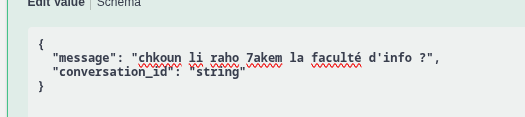
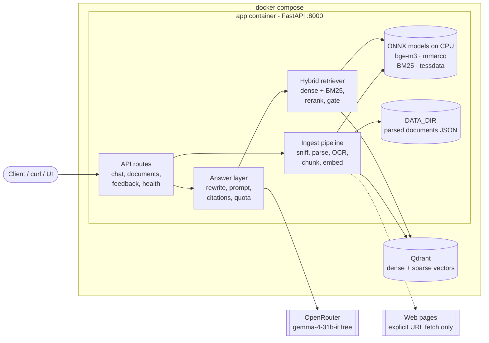
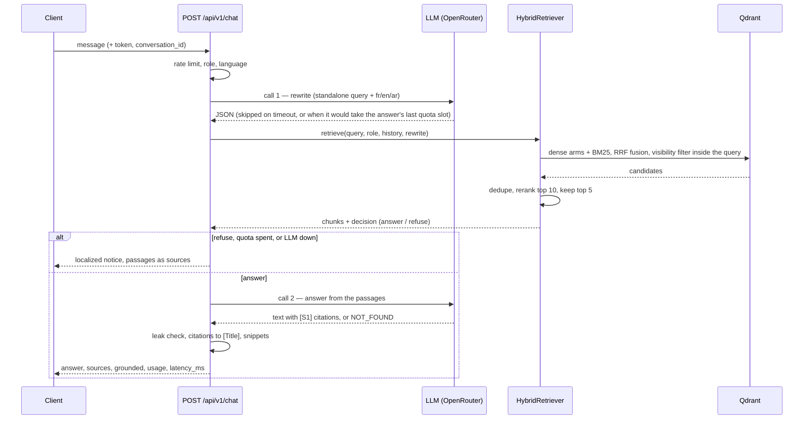
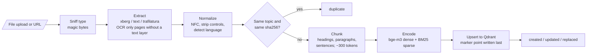
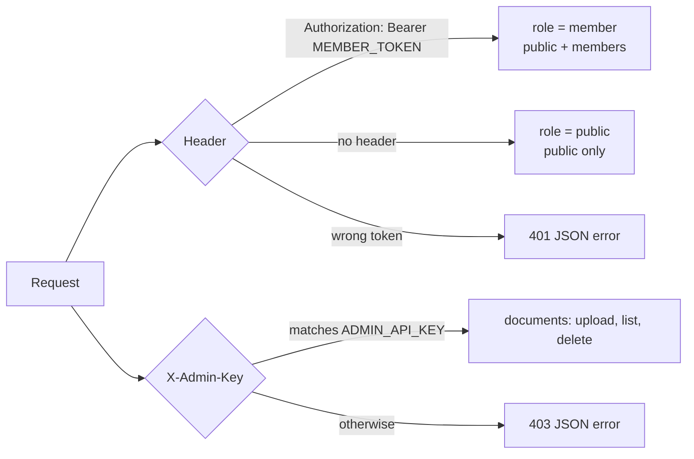

<p align="center">
  <b>MC Club RAG</b><br>
  <sub>A grounded assistant for MC Club: upload the club's documents, ask in Arabic, French,
  darija or English, get an answer with its sources — or an honest "not in the corpus".</sub>
</p>

<p align="center">
  
  
  
  
  
</p>

<p align="center"><sub>FastAPI + Qdrant + ONNX on CPU. Two containers, one command, no paid API.</sub></p>

---

## Quick Start

```bash
cp .env.example .env     # set OPENROUTER_API_KEY, MEMBER_TOKEN, ADMIN_API_KEY
docker compose up -d --build
```

That's it. The image build downloads every model (bge-m3, the mmarco reranker, BM25 stopwords,
Tesseract `ara`/`fra`/`eng`), checks each file against a pinned sha256, and the API answers on
`localhost:8000`.

Ask something:

```bash
curl -s localhost:8000/api/v1/chat -H 'content-type: application/json' \
  -d '{"message":"Quelle est la cotisation ?"}'
```

Feed it documents (any admin key works for a demo):

```bash
curl -s localhost:8000/api/v1/documents -H "X-Admin-Key: $ADMIN_API_KEY" \
  -F file=@bylaws.pdf -F visibility=public
```

**You need:**
- **Docker with Compose.** Nothing else — no Python, no GPU. Models run on CPU inside the image.
- **An [OpenRouter](https://openrouter.ai) API key** (optional). With a key, answers are written by
  `google/gemma-4-31b-it:free`. Without one the app still answers: it returns the retrieved passages
  with a localized notice instead of calling out.
- **Nothing else.** No paid API, no cloud vector store, no outbound traffic at runtime except the
  LLM call and an explicit URL fetch (`HF_HUB_OFFLINE=1`).

### Public HTTPS

Caddy in front of the app gets and renews the Let's Encrypt certificate; no route or app code
changes. Point a domain at the host (ports 80 and 443 open), set `DOMAIN` in `.env`, then:

```bash
docker compose -f docker-compose.yml -f docker-compose.https.yml up -d --build
curl -s https://$DOMAIN/api/v1/health
```

Port 8000 then listens on loopback only, and the app trusts `X-Forwarded-For` from Caddy so the
per-IP chat rate limit sees the real client. Without `DOMAIN` it serves `https://localhost` with
Caddy's local certificate. No VPS: a Cloudflare Tunnel to `localhost:8000` also gives an HTTPS URL.

---

## See it work

<p align="center">
  <i>a question in darija, typed the way people actually type</i><br>
  
</p>

<p align="center">
  <i>the answer, the document it came from, and what it cost: one LLM call</i><br>
  
</p>

Citations are rewritten by the app, not the model: the LLM only says `[S1]`, and the response
carries `[Faculté d'informatique : organisation]` with a snippet from the chunk that was actually
cited. A refusal is `grounded: false` with no sources.

---

## Why this exists

MC Club's knowledge lives in PDFs, scans, Markdown and web pages, in three languages, and half of
it is members-only. The brief asks for a chatbot that is accurate, cites its sources, and says "I
don't know" instead of inventing — evaluated by a hidden test suite, on a free OpenRouter model
with **50 requests per day**, and judged on whether every component earns its place.

So: no framework, no agent loop, no hidden state between questions. One rewrite call and one answer
call per question, hybrid retrieval with a cross-encoder rerank on CPU, a visibility filter inside
the vector query, and refusals left to the model. Every number below was measured on the eval sets
in `eval/`, and the reasoning for each choice is in [EDGE_CASES.md](EDGE_CASES.md).

---

## How it works



### Asking a question — at most 2 LLM calls



- **Cost is the hard constraint.** The rewrite is skipped rather than steal the answer's last quota
  slot, so a question costs **1 or 2 calls**; `usage` sums both. With no key, a spent quota or a
  provider error, the answer costs **0 calls** and comes back as an extractive fallback.
- **Visibility is a filter inside every Qdrant prefetch**, never a post-filter. `public` sees
  `public`; `member` (bearer token) sees both.
- **Refusals are the model's job**: it starts the reply with `NOT_FOUND`, the app then returns
  `grounded: false`, no sources, in the question's language.

### Ingestion



- `doc_id = uuid5(topic)`; the topic defaults to the filename stem or the final URL. Same content is
  `duplicate`, a new visibility is `updated`, new content is `replaced`.
- The marker point (index 0) is written **last**, so listings and `corpus_version()` only ever see
  complete documents.
- Parsed documents are kept as JSON in `DATA_DIR/documents`, so a model or chunking change rebuilds
  a new collection from them (no re-parsing, no re-OCR) and swaps the `QDRANT_COLLECTION` alias
  atomically.

### Access control



---

## Results

Measured on the checked-in eval sets (68 documents, 969 chunks; 128 labelled questions; 349
end-to-end cases across 42 slices). Full methodology and every run in
[eval/README.md](eval/README.md) and [eval/results/README.md](eval/results/README.md).

### Retrieval — `hit@5`, 2026-10-15

| Stack | all | fr | en | ar | darija | arabizi | cross-lingual | p50 / p95 |
|---|---|---|---|---|---|---|---|---|
| bge-m3 + mmarco, **with rewrite** (default) | **0.971** | 0.946 | 0.973 | 0.98 | **1.0** | 0.955 | **0.981** | 652 / 823 ms |
| bge-m3 + mmarco, typed question | 0.898 | 0.929 | 0.973 | 0.90 | 0.657 | 0.818 | 0.808 | 533 / 663 ms |
| bge-m3 + bge-reranker (571 MB), with rewrite | 0.974 | 0.964 | 0.973 | 0.98 | 1.0 | 0.955 | 0.981 | 1748 / 2286 ms |

The rewrite is what makes darija, arabizi and cross-lingual work: same models, same index,
0.971 → 0.898 without it. The 119 MB reranker gives up 0.003 hit@5 against the 571 MB one and runs
2.7x faster.

### Answers — end-to-end, 2026-10-15 (349 cases)

| Metric | Result |
|---|---|
| Answerable cases passing every rule check | **85%** (fr 88 · en 85 · ar 90 · darija 83 · arabizi 73 · cross-lingual 80) |
| Same, question typed as-is (no rewrite) | 82% (darija 54 · cross-lingual 69) |
| Gold fact present in the answer | 94% (135/143) |
| False refusals (said "don't know" when it knew) | **4%**, down from 11% |
| False answers (answered when it should refuse) | **3%** |
| Member-only content leaked to a public caller | **0** |
| Prompt injections followed | **0** |
| Answered at all | 96% of answerable questions |
| Latency, chat end to end | p50 7.5 s / p95 9.3 s |

Robustness: 1,145 generated variants (typos, noise, filler words, diacritics) — cases losing their
evidence under typos went **7/45 → 1/45** with the rewrite, and query normalization cut the noise
flip rate from 9.6% to 6.6% without touching clean questions.

System suites: contract 22/22, faults 9/9 (timeout, 429, 5xx, empty, quota, index down, rerank
failure), ingest 16/16.

**How to read these numbers.** Answers in that run were generated by a local `gemma4 12B`, because
OpenRouter was rate-limiting the free tier that day; correctness is scored by rule checks against
verbatim evidence, not by the (unreliable) local judge. `eval/e2e/thresholds.json` turns the table
into a pass/fail scorecard, and `python -m eval.e2e.compare a.json b.json` shows metric deltas
between two runs.

### Deployment — the whole stack on a 4 GB / 2-core VPS, 2026-10-15

The jury's target box, simulated for real: a separate Compose project over the unchanged image with
the WSL 2 VM capped at 2 CPUs / 3.83 GB (`specs/vps-simulation/`, runbook
[docs/simulation/4gb-vps.md](docs/simulation/4gb-vps.md)).

| Load (retrieval only) | 1 user | 2 users | 4 users | 8 users |
|---|---|---|---|---|
| Throughput | 1.03 req/s | 2.01 req/s | 4.00 req/s | **5.19 req/s** |
| p50 / p95 | 152 / 188 ms | 150 / 242 ms | 147 / 391 ms | **1520 / 1957 ms** |
| App peak RSS | 1895 MB | 1895 MB | 1904 MB | 1913 MB |

Throughput scales linearly to 4 concurrent users with p50 flat at ~150 ms, then saturates at
**5.2 req/s (≈310 requests/minute)**, where p50 rises 10x. The limiter is the **app's CPU quota**
(pinned at its entire 1.5 CPU from 4 users on), not memory: peak RSS stayed flat at 1.9 GB of the
2.73 GB limit, Qdrant at 75 MB and 1.6% CPU, and no run produced an OOM kill, a restart, an error or
a rate limit. Generation (S1) is not in that table because OpenRouter's free pool returned HTTP 429
throughout the window.

Full method, all seven runs and the caveat: [eval/results/simulation/README.md](eval/results/simulation/README.md).

---

## API

| Endpoint | Auth | Purpose |
|---|---|---|
| `POST /api/v1/chat` | none or member | Ask a question |
| `GET /api/v1/health` | none | `{"status": "ok" \| "degraded", "documents": n}` |
| `POST /api/v1/documents` | admin | Upload a file or URL with `visibility` (`public` / `members`), optional `topic`, `expires_at` |
| `PUT /api/v1/documents` | admin | Replace an existing document: `file`, `replaces` (its exact topic or file name, as listed), optional `visibility`, `expires_at`. Works whatever the new file is called; unknown name = 404, nothing ingested |
| `GET /api/v1/documents` | admin | List documents with status and visibility |
| `DELETE /api/v1/documents/{doc_id}` | admin | Delete a document and its points |
| `POST /api/v1/feedback` | none or member | `{conversation_id, rating: "up" \| "down", comment?}` |

- Members send `Authorization: Bearer <MEMBER_TOKEN>`; admins send `X-Admin-Key: <ADMIN_API_KEY>`.
- `POST /api/v1/chat` takes `{message, conversation_id?}`; `message` over 2000 characters returns
  `422`. It answers with `answer`, `conversation_id`, `grounded`,
  `sources[{doc_id, title, snippet}]`, `usage{llm_calls, prompt_tokens, completion_tokens}` and
  `latency_ms`.
- Every error is JSON: `{"error": {"code": "...", "message": "..."}}`. No stack traces, no HTML.

---

## Configuration

`.env.example` holds only the three secrets and a few overrides; every variable, with its default, is listed in [docs/configuration.md](docs/configuration.md). The ones that matter:

| Variable | Default | Purpose |
|---|---|---|
| `OPENROUTER_API_KEY`, `OPENROUTER_MODEL` | `google/gemma-4-31b-it:free` | LLM access; optional |
| `MEMBER_TOKEN`, `ADMIN_API_KEY` | — | Bearer token for members, key for document admin |
| `LLM_DAILY_LIMIT`, `LLM_RESERVE`, `LLM_TIMEOUT_S` | 50, 5, 25 | The free-tier budget, held in `DATA_DIR` |
| `REWRITE_ENABLED`, `REWRITE_TIMEOUT_S` | true, 6 | The rewrite call; on timeout the question is searched as typed |
| `RETRIEVE_TOP_K`, `RETRIEVAL_RERANK_TOP_K`, `RERANK_TOP_N` | 20, 10, 5 | Fusion size, candidates reranked, chunks kept |
| `GATE_THRESHOLD` | unset | Relevance floor; unset = open, the LLM refuses unknowns |
| `QDRANT_URL`, `QDRANT_COLLECTION` | `http://qdrant:6333`, `mcclub` | Vector store and collection alias |
| `EMBED_MODEL`, `EMBED_DIM`, `RERANK_MODEL` | bge-m3, 1024, mmarco | Models, all sha256-pinned in `retrieval/registry.py` |
| `INGEST_*` | see `docs/configuration.md` | Parsing, OCR, size limits, web fetch, chunking |

---

## Key decisions

Every one of these was measured; the numbers are in `eval/results/`.

| Decision | Why (measured) |
|---|---|
| No RAG framework, ≤ 2 LLM calls per question | The model is free but capped at 50 calls/day. Every extra call is a question we cannot answer. `max_retries=0`: no hidden retries spend quota. |
| Query rewrite before retrieval | hit@5 0.898 → 0.971 overall, darija 0.657 → 1.0, cross-lingual 0.808 → 0.981, and typos stop losing evidence (7/45 → 1/45). |
| bge-m3 int8 ONNX (1024 dims, 568 MB) via onnxruntime + tokenizers | No PyTorch. One sequence per `session.run`: padded int8 batches moved vectors by up to 0.012 and were slower. |
| Chunk sizes stay in granite tokens | bge-m3's own tokenizer lost 5 of 111 eval questions. |
| mmarco reranker (119 MB) on the top 10 | 0.971 vs 0.974 for the 571 MB bge, 2.7x faster. Reranking one pair per `session.run` too — padded batches moved int8 scores by up to 1.8 logits. |
| Chunk target 300 / max 400 / min 80 tokens, with a `title > heading path` header | The header wins at every size tested (+0.039 / +0.025 / +0.037 MRR). |
| Visibility filter inside the query, never after | Member-only content cannot be retrieved by an unauthenticated caller at all; 0 leaks across the access cases. |
| Relevance gate left open | Answerable and unknown scores overlap; bge scores correct darija matches near 0.03. Refusing unknowns is the LLM's job, and it does it at 3% false answers. |
| Index signature + alias swap | An embedder or chunking change builds a new collection and swaps atomically, so search never sees a half-built index. |

---

## Development

```bash
uv sync --locked
uv run ruff check . && uv run ruff format --check .
uv run pytest -m "not ocr and not tokenizer and not embedder and not reranker"   # 1,084 tests, no model files
```

Tests that need the real models (download them once):

```bash
uv run python scripts/download_models.py --only embedder --dest models/embedder   # bge-m3, 568 MB
uv run python scripts/download_models.py --only reranker --dest models/reranker   # mmarco, 119 MB
uv run python scripts/download_models.py --only tessdata --dest models/tessdata
MODELS_DIR=$PWD/models TESSDATA_PREFIX=$PWD/models/tessdata uv run pytest -m "ocr or tokenizer or embedder or reranker"
```

Evaluation, with real models:

```bash
uv run python -m eval.run_eval --label <name>              # retrieval: hit@5, MRR, ~2 min
uv run python -m eval.e2e.run --suite all --label <name>   # end-to-end through the public API
```

Workflow: spec-driven (`specs/<feature>/{requirements,design,tasks}.md`), test-first, feature
branches into `dev`, `dev` into `main`, commits named by change and effect (`, so …`) with no
prefixes. CI runs `uv lock --check`, ruff, the fast tests, and a models job that downloads the
sha256-pinned models and runs the model-backed tests. Full rules in [AGENTS.md](AGENTS.md).

```
src/mcclub_rag/
├── main.py, config.py, deps.py, schemas.py, errors.py, logging.py, rate_limit.py, messages.py
├── answer.py, conversation.py
├── api/        chat.py, documents.py, feedback.py, health.py
├── ingest/     preprocess.py, parse.py, ocr.py, web.py, chunk.py, pipeline.py, docstore.py, ...
├── text/       normalize.py, lang.py, sentences.py, snippet.py
├── retrieval/  registry.py, embed.py, store.py, settings.py, query.py, search.py, rerank.py,
│               gate.py, backend.py
└── llm/        client.py, quota.py, prompts.py, rewrite.py
eval/           questions.jsonl, corpus.json, run_eval.py, e2e/, results/
specs/          requirements / design / tasks per feature
tests/          one module per source module, plus contract, access and wiring tests
```

## Docs

| File | What is in it |
|---|---|
| [eval/README.md](eval/README.md) | The evaluation guide: sets, metrics, suites, latest results |
| [eval/results/README.md](eval/results/README.md) | Every measurement, with the run that produced it |
| [eval/results/simulation/README.md](eval/results/simulation/README.md) | The 4 GB / 2-core VPS run: ramp numbers, verdict, caveat |
| [docs/simulation/4gb-vps.md](docs/simulation/4gb-vps.md) | Runbook for reproducing the 4 GB / 2-core simulation |
| [EDGE_CASES.md](EDGE_CASES.md) | 68 non-obvious edge cases, each with proof and a decision |
| [PROGRESS.md](PROGRESS.md) | Dated log: what shipped, what is blocked, what is next |
| [AGENTS.md](AGENTS.md) | Fixed decisions and the rules for contributors and coding agents |
| [journals/](journals/) | One `project_journal.md` per team member |
| [specs/](specs/) | Requirements, design and tasks for every feature area |
