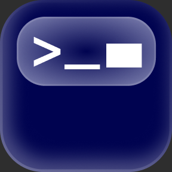
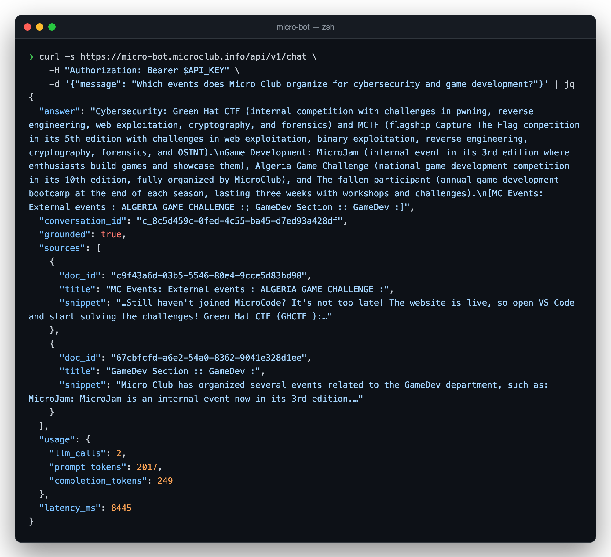
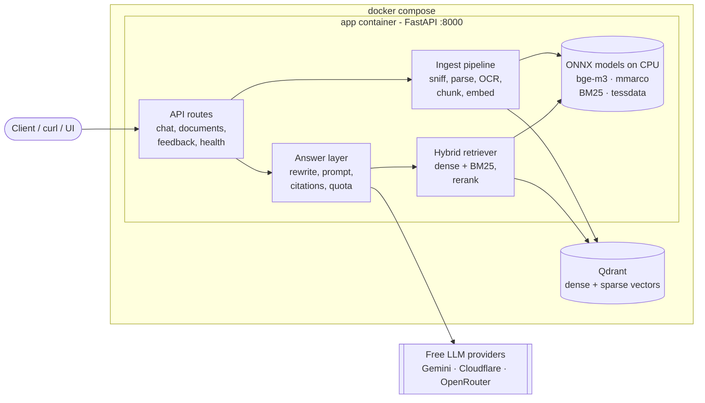

<p align="center">
  
</p>

<h1 align="center">Micro Bot</h1>

<p align="center">
  <b>The AI assistant of <a href="https://github.com/MicroClub-USTHB">Micro Club</a> (USTHB, Algiers).</b><br>
  <sub>Upload the club's documents, ask in Arabic, French, darija, arabizi or English, and get a
  grounded answer with its sources, or an honest "not in the documents".</sub>
</p>

<p align="center">
  <a href="https://github.com/MicroClub-USTHB/micro-bot/actions/workflows/ci.yml"></a>
  
  
  
  
</p>

<p align="center">
  
</p>

---

## Highlights

- **Multilingual for real.** Arabic, French, English, Algerian darija and arabizi, mixed in one
  question. A query rewrite translates each question so a French document answers an Arabic one.
- **Grounded or silent.** Every answer cites the documents it came from. When the answer isn't
  there, Micro Bot says so instead of inventing.
- **Streams its answers.** Send `"stream": true` to get the answer token by token over
  Server-Sent Events, citations included.
- **Any document.** PDF, scanned PDF and photos (Tesseract OCR), Office files, Markdown, text and
  web pages.
- **Free to run, all day.** At most 2 LLM calls per question, spread over free tiers that need no
  credit card (Gemini, Cloudflare Workers AI, OpenRouter), repeated questions served from a cache, and the
  embedder, reranker and OCR all run on CPU inside the container. No GPU, no paid API.
- **Plain Python.** FastAPI + Qdrant + ONNX Runtime. No LangChain, no LlamaIndex, no agent loop.

## Quick start

You need **Docker** and **make**. An LLM key is optional ([Gemini](https://aistudio.google.com),
[Cloudflare](https://dash.cloudflare.com) or [OpenRouter](https://openrouter.ai/keys), all free):
without one, Micro Bot returns the most relevant passages instead of a written answer.

```bash
git clone https://github.com/MicroClub-USTHB/micro-bot.git && cd micro-bot
make dev                                  # creates .env, builds, starts, waits for health
```

The first build downloads about 700 MB of models (each sha256-checked). Then add your key to
`.env` (`GEMINI_API_KEY=...`), run `make restart`, and feed it documents:

```bash
make ingest DOCS=path/to/folder           # uploads every file of the folder
make ask Q="Quand le club a-t-il été fondé ?"
```

The API listens on `http://localhost:8000`.

## Commands

| Command | What it does |
|---|---|
| `make dev` | Create `.env` with fresh secrets if missing, build and start the stack, wait for health |
| `make up` / `make down` / `make restart` | Start, stop (data kept) or restart the containers |
| `make logs` / `make ps` / `make health` | Follow API logs, show containers, check health |
| `make ingest DOCS=dir` | Upload a folder of documents |
| `make stream Q="..."` | Stream an answer from the terminal |
| `make ask Q="..."` | Ask a question from the terminal |
| `make docs` | List indexed documents |
| `make install` / `make models` | Install Python deps with uv / download the models locally |
| `make test` / `make test-models` | Fast tests / tests that need the model files |
| `make lint` / `make format` / `make check` | Lint, auto-fix, or run what CI runs |
| `make eval` | Retrieval evaluation with the real models |
| `make clean` | Stop the stack, delete its volumes (index and stored documents) and caches |
| `make reset` | `clean`, plus delete the local image, models and `.venv` (asks first) |

Run `make` alone to list them.

## How it works



**Asking a question** (at most 2 LLM calls):

1. **Rewrite** (call 1): the LLM turns the question into a standalone query plus French, English and
   Arabic translations. Skipped if it would spend the answer's last quota slot.
2. **Retrieve**: dense (bge-m3) and BM25 search in Qdrant, fused with RRF (expired documents filtered
   inside the query).
3. **Rerank**: a multilingual cross-encoder (mmarco MiniLM) reranks the top 10 and keeps the top 5.
4. **Answer** (call 2): the LLM answers from those passages only and cites them. The app rewrites
   citations as document titles and attaches snippets. If the model can't answer, the reply is
   `grounded: false` with no sources, in the question's language.

**Ingesting a document**: sniff the real type from magic bytes, then extract the text (xberg,
Tesseract OCR only for pages without a text layer, trafilatura for web pages). Normalize, detect
the language, and chunk by headings and sentences (~300 tokens). Then embed dense + sparse and
upsert. Uploading the same file twice is a no-op. A new version replaces the old one atomically.

**Access**: everything is public to chat users. Chat needs `Authorization: Bearer <API_KEY>`;
`X-Admin-Key: <ADMIN_API_KEY>` manages documents.

## API

Every chat call needs `Authorization: Bearer <API_KEY>`. Every document call needs
`X-Admin-Key: <ADMIN_API_KEY>`. All documents are visible to every chat user.

| Endpoint | Auth | Purpose |
|---|---|---|
| `POST /api/v1/chat` | API key | `{message, conversation_id?, stream?}`: ask a question |
| `POST /api/v1/feedback` | API key | `{conversation_id, rating: "up" \| "down", comment?}` |
| `GET /api/v1/health` | none | `{"status": "ok" \| "degraded", "documents": n}` |
| `POST /api/v1/documents` | admin | Create: upload `file`, optional `topic`, `expires_at` |
| `GET /api/v1/documents` | admin | List documents |
| `GET /api/v1/documents/{doc_id}` | admin | Read one document (404 if unknown) |
| `PUT /api/v1/documents/{doc_id}` | admin | Update: replace its file (`file`, optional `expires_at`) |
| `PUT /api/v1/documents` | admin | Update by name: `file`, `replaces` (its listed topic or file name) |
| `DELETE /api/v1/documents/{doc_id}` | admin | Delete a document |

A chat reply carries `answer`, `conversation_id` (send it back for follow-ups), `grounded`,
`sources[{doc_id, title, snippet}]`, `usage{llm_calls, prompt_tokens, completion_tokens}` and
`latency_ms`. Every error is JSON: `{"error": {"code": "...", "message": "..."}}`.

### Streaming

Send `"stream": true` (default `false`) to get the answer as it is written, as
[Server-Sent Events](https://developer.mozilla.org/docs/Web/API/Server-sent_events):

| Event | Data |
|---|---|
| `meta` | `{"conversation_id": "..."}`, sent first |
| `delta` | `{"text": "..."}`, a piece of the answer, citations already shown as `[Title]` |
| `done` | the full chat reply, same shape as `stream: false`. Its `answer` is authoritative |
| `error` | `{"error": {"code", "message"}}`, then the stream ends |

Auth, validation and the rate limit fail before the stream starts, with a normal HTTP status.
A refusal marker or a reply that repeats the instructions is never streamed.

<details>
<summary>curl examples</summary>

```bash
# ask
curl -s localhost:8000/api/v1/chat -H "Authorization: Bearer $API_KEY" \
  -H 'content-type: application/json' -d '{"message":"chhal mn edition dar MCTF?"}'

# stream (-N: print events as they arrive)
curl -sN localhost:8000/api/v1/chat -H "Authorization: Bearer $API_KEY" \
  -H 'content-type: application/json' -d '{"message":"What is MicroHack?","stream":true}'

# upload, read, replace, delete a document
curl -s localhost:8000/api/v1/documents -H "X-Admin-Key: $ADMIN_API_KEY" -F file=@bylaws.pdf
curl -s localhost:8000/api/v1/documents/$DOC_ID -H "X-Admin-Key: $ADMIN_API_KEY"
curl -s -X PUT localhost:8000/api/v1/documents/$DOC_ID -H "X-Admin-Key: $ADMIN_API_KEY" -F file=@bylaws-v2.pdf
curl -s -X DELETE localhost:8000/api/v1/documents/$DOC_ID -H "X-Admin-Key: $ADMIN_API_KEY"
```
</details>

## Configuration

`.env` needs only three values. Everything else has a tested default in the settings classes
(`config.py`, `ingest/settings.py`, `retrieval/settings.py`), with the reason next to it.

| Variable | Default | Purpose |
|---|---|---|
| `GEMINI_API_KEY` | none | Main LLM (free, no card). Set `GEMINI_DAILY_LIMIT` to your AI Studio quota |
| `CLOUDFLARE_ACCOUNT_ID`, `CLOUDFLARE_API_TOKEN` | none | Workers AI fallback, ~120 answers/day free |
| `OPENROUTER_API_KEY` | none | Last fallback, 50 requests/day free |
| `LLM_PROVIDERS` | `gemini,cloudflare,openrouter` | Order the providers are tried in |
| `API_KEY`, `ADMIN_API_KEY` | none | Bearer key for chat, key for document admin |
| `GEMINI_MODEL`, `CLOUDFLARE_MODEL`, `OPENROUTER_MODEL` | `gemini-3.5-flash-lite`, `@cf/openai/gpt-oss-120b`, `google/gemma-4-31b-it:free` | Answer model per provider (Gemini's rewrite uses `gemini-3.6-flash`) |
| `LLM_DAILY_LIMIT`, `LLM_RESERVE` | 1500, 5 | Overall daily cap across providers, and the margin held back |
| `REWRITE_ENABLED` | true | `false` = 1 LLM call per question |
| `QDRANT_URL` | `http://qdrant:6333` | Vector store |
| `LOG_LEVEL` | INFO | Log level |

## Deploy

The root `docker-compose.yml` is the whole deployment: the app and Qdrant, with named volumes for
the index and stored documents.

```bash
cp .env.example .env    # fill in the secrets (or: make env)
docker compose up -d --build
```

- **Server:** 2 CPU cores and 4 GB RAM are enough. The app uses about 1.8 GB, Qdrant about 130 MB.
- **HTTPS:** put it behind any reverse proxy on port 8000. On [Dokploy](https://dokploy.com) or
  Coolify, create a Compose service from this repo, paste the `.env` values into the Environment
  tab, and add a domain for service `app`, port `8000`.

## Results

Measured on the checked-in eval sets: 68 documents, 128 labelled retrieval questions, and 349
end-to-end cases across 42 slices. Details in [eval/README.md](eval/README.md).

| Metric | Result |
|---|---|
| Retrieval hit@5 (all / darija / cross-lingual) | **0.971** / 1.0 / 0.981 |
| Answerable questions passing every rule check | **85%** |
| False refusals / false answers | 4% / 3% |
| Prompt injections followed | **0** |
| Retrieval latency p50 / p95 | 652 / 823 ms |

The query rewrite does the heavy lifting: without it, hit@5 drops to 0.898 (darija 0.657).

## Development

```bash
make install     # uv sync
make check       # lock check, ruff, 1,000+ fast tests
make models      # download models once
make test-models # OCR, tokenizer, embedder and reranker tests
```

```
src/micro_bot/
├── main.py, config.py, schemas.py, errors.py, answer.py, conversation.py, ...
├── api/        chat, documents, feedback, health routes
├── ingest/     sniff, parse, OCR, web, chunk, pipeline, docstore
├── retrieval/  embed, store, search, rerank, gate, backend
├── text/       normalize, language detection, snippets
└── llm/        client, quota, prompts, rewrite
eval/           retrieval + end-to-end evaluation harness
specs/          requirements / design / tasks per feature
tests/          unit, contract, access and wiring tests
```

Contributing rules and fixed design decisions are in [AGENTS.md](AGENTS.md). Branch from `dev`,
keep `make check` green, and open a PR to `dev`.

---

<p align="center"><sub>Built by Micro Club members, USTHB, Algiers.</sub></p>
