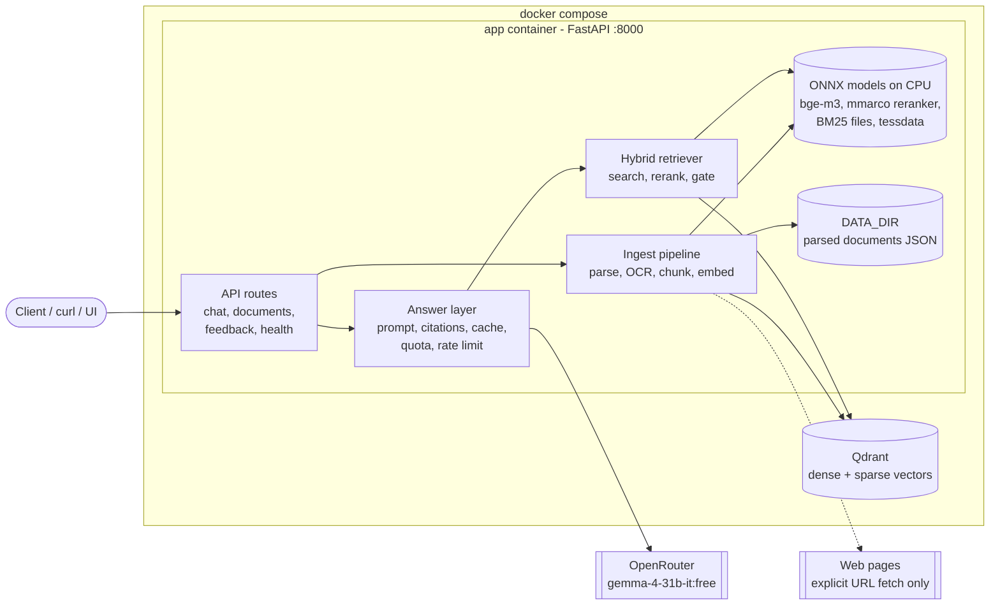
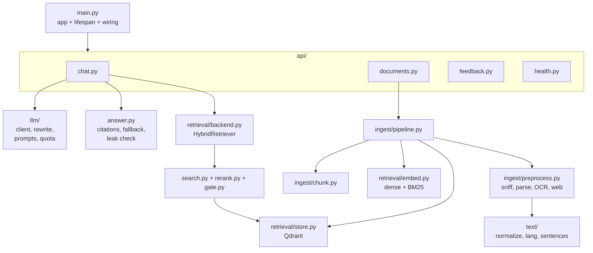
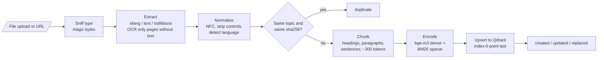
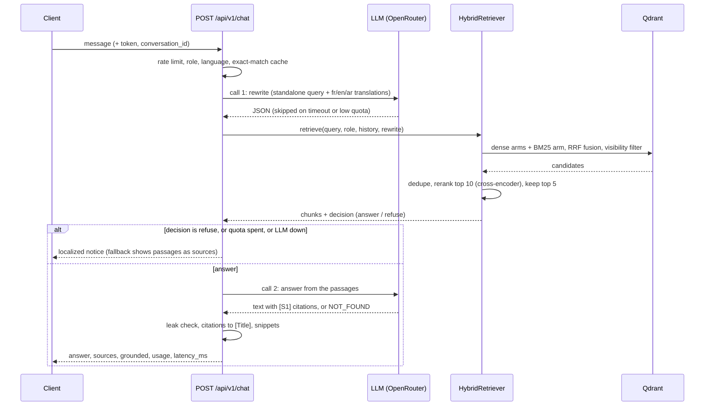
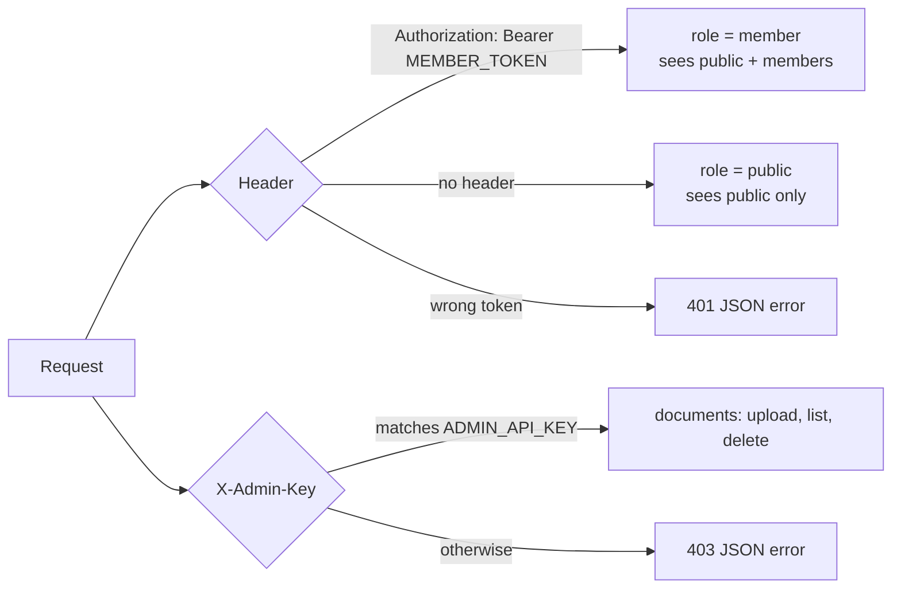
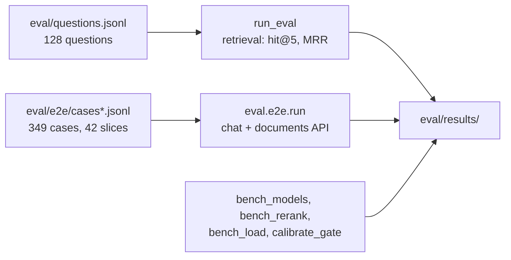

# mcclub-rag

RAG chatbot for the MC Club RAG Chatbot Challenge. Upload documents (files or web pages, Arabic /
French / English, scans included), ask questions in any of the three languages, and get a
**grounded answer with sources**. Member-only documents stay hidden from public callers.

Plain Python (FastAPI, Qdrant, ONNX models on CPU). Runs offline in a container; the only outbound traffic is the
explicit URL fetch and the OpenRouter LLM calls (at most 2 per question).

Version **0.1.0**.

## Contents

- [Features](#features)
- [Architecture](#architecture)
- [How it works](#how-it-works)
- [Quickstart](#quickstart)
- [Configuration](#configuration)
- [API](#api)
- [Development](#development)
- [Evaluation](#evaluation)
- [Key decisions](#key-decisions)
- [Repository layout](#repository-layout)
- [More docs](#more-docs)

## Features

- **Multilingual**: Arabic, French, English, often mixed in one document or question; also darija
  and arabizi.
- **Ingestion**: PDF, images (OCR with Tesseract `ara`/`fra`/`eng`), text/Markdown, and web pages.
- **Hybrid retrieval**: dense (bge-m3) + BM25 sparse, fused in Qdrant, then a cross-encoder rerank.
- **Grounded answers**: citations rewritten as document titles, snippets from the cited chunk,
  and a refusal when the corpus does not hold the answer.
- **Access control**: `public` and `members` visibility, enforced inside the vector query.
- **Safeguards**: SSRF guard on URL fetch, prompt-injection and prompt-leak checks, rate limiting,
  a daily LLM quota with a circuit breaker, and an extractive fallback when the LLM is unavailable.

## Architecture



Two containers: `app` (the API plus all models, loaded once at startup) and `qdrant` (persistent
volume). Models are downloaded and sha256-verified at image build time; at runtime
`HF_HUB_OFFLINE=1`.

### Module map



## How it works

### Ingestion



- `doc_id = uuid5(topic)`; topic defaults to the filename stem or the final URL. Same content is
  `duplicate`, a new visibility is `updated`, new content is `replaced` (new points written first,
  old ones deleted after).
- The index-0 point of each version is written last, so listings and `corpus_version()` only see
  complete documents.
- Parsed documents are kept as JSON in `DATA_DIR/documents`; a model or chunking change rebuilds a
  new collection from them (no re-parsing) and swaps the `QDRANT_COLLECTION` alias atomically.

### Answering a question



Key behaviours:

- **At most 2 LLM calls per question**: the query rewrite (skipped when it would take the answer's
  last quota slot) and the answer. Cached repeats use 0.
- **Visibility** is a filter inside every Qdrant prefetch and the fused query, never applied after
  the fact. Roles: `public` sees `public`; `member` sees both.
- **Refusals**: the model starts with `NOT_FOUND` when the passages don't answer; the reply is then
  `grounded=false` with no sources, in the question's language.
- **Cache**: exact match on question + role + corpus version (no semantic cache). Skipped inside a
  conversation.
- **Without an LLM** (no key, quota spent, provider error, breaker open) the answer is a notice in
  the user's language with the best passages as sources.

### Access control



## Quickstart

Requirements: Docker with Compose, an [OpenRouter](https://openrouter.ai) API key (optional: without
it the app answers with the fallback notice).

```bash
cp .env.example .env   # set OPENROUTER_API_KEY, MEMBER_TOKEN, ADMIN_API_KEY
docker compose up -d --build   # downloads and sha256-checks the models at build time
```

The API listens on port 8000. Upload a document, then ask a question:

```bash
curl -H "X-Admin-Key: $ADMIN_API_KEY" -F file=@bylaws.pdf -F visibility=public \
  localhost:8000/api/v1/documents
```

```bash
curl -H 'content-type: application/json' -d '{"message":"Quelle est la cotisation ?"}' \
  localhost:8000/api/v1/chat
```

Bulk-load a folder (needs Qdrant reachable):

```bash
uv run python scripts/ingest_folder.py <dir> --visibility public
```

Rebuild the index after changing the embedder or chunking:

```bash
uv run python scripts/reindex.py
```

## Configuration

Environment variables via pydantic-settings; every variable is documented in
[.env.example](.env.example). The main ones:

| Variable | Purpose |
|---|---|
| `OPENROUTER_API_KEY`, `OPENROUTER_MODEL` | LLM access (default `google/gemma-4-31b-it:free`) |
| `MEMBER_TOKEN`, `ADMIN_API_KEY` | Bearer token for members, key for document admin |
| `QDRANT_URL`, `QDRANT_COLLECTION` | Vector store endpoint and alias |
| `EMBED_MODEL`, `EMBED_DIM`, `RERANK_MODEL` | Models (registry in `retrieval/registry.py`) |
| `LLM_DAILY_LIMIT`, `LLM_RESERVE`, `LLM_TIMEOUT_S` | Daily quota and timeout |
| `REWRITE_ENABLED`, `REWRITE_TIMEOUT_S` | Query rewrite call |
| `RETRIEVE_TOP_K`, `RERANK_TOP_N`, `GATE_THRESHOLD` | Retrieval sizes and relevance floor (unset = open) |
| `CHAT_RATE_LIMIT_REQUESTS`, `CHAT_RATE_LIMIT_WINDOW_S` | Per-IP chat rate limit |
| `INGEST_*` | Parsing, OCR, size limits, web fetch, chunking |
| `MODELS_DIR`, `DATA_DIR` | Model files and persistent app data |

## API

| Endpoint | Auth | Purpose |
|---|---|---|
| `POST /api/v1/chat` | none or member | Ask a question |
| `GET /api/v1/health` | none | Readiness of the app and document store |
| `POST /api/v1/documents` | admin | Upload a file or URL, with `visibility` |
| `GET /api/v1/documents` | admin | List documents |
| `DELETE /api/v1/documents/{doc_id}` | admin | Delete a document |
| `POST /api/v1/feedback` | none or member | Rate an answer |

- Members send `Authorization: Bearer <MEMBER_TOKEN>`; admins send `X-Admin-Key: <ADMIN_API_KEY>`.
- Chat response: `answer`, `conversation_id`, `grounded`, `sources[{doc_id, title, snippet}]`,
  `usage{llm_calls, prompt_tokens, completion_tokens}`, `latency_ms` (integer). A `message`
  longer than 2000 characters returns 422.
- Errors are always JSON: `{"error": {"code": "...", "message": "..."}}`.

## Development

```bash
uv sync --locked
uv run ruff check . && uv run ruff format --check .
uv run pytest -m "not ocr and not tokenizer and not embedder and not reranker"   # no model files
```

Tests that need real models (download them first):

```bash
uv run python scripts/download_models.py --only tessdata --dest models/tessdata
uv run python scripts/download_models.py --only embedder --dest models/embedder   # bge-m3, 568 MB
uv run python scripts/download_models.py --only bm25 --dest models/bm25
uv run python scripts/download_models.py --only reranker --dest models/reranker   # mmarco, 119 MB
MODELS_DIR=$PWD/models TESSDATA_PREFIX=$PWD/models/tessdata uv run pytest -m "ocr or tokenizer or embedder or reranker"
```

Workflow: spec-driven (`specs/<feature>/requirements.md`, `design.md`, `tasks.md`), test-first,
feature branches into `dev`, `dev` into `main`, conventional commits. CI runs `uv lock --check`,
ruff, the fast tests, and a models job that runs the model-backed tests. See
[AGENTS.md](AGENTS.md) for the full rules.

## Evaluation



Retrieval eval (real models, in-memory Qdrant, about 2 minutes):

```bash
uv run python -m eval.run_eval --label <name>
```

End-to-end eval (in-process, real models; `--target http` for a running app):

```bash
uv run python -m eval.e2e.run --suite all --label <name>
```

Latest (2026-10-15, 349 cases): retrieval hit@5 0.97, 85% of answerable questions pass every rule
check, 4% false refusals, 3% false answers. Answers were judged with a local gemma4 12B, not yet
the production model. Cited snippets show the evidence 87% of the time (target 90%); arabizi
questions are answered in French or English. Details, metrics and the issue index are in
[eval/README.md](eval/README.md) and [eval/results/README.md](eval/results/README.md).

## Key decisions

- **No framework**: at most 2 LLM calls per question, every call explicit (no hidden retries that
  spend quota).
- **Qdrant hybrid search** (dense + BM25), visibility filter inside the query.
- **Embedder**: `BAAI/bge-m3` int8 ONNX (1024 dims), via onnxruntime + tokenizers, no PyTorch. One
  sequence per `session.run`: padded batches moved int8 vectors.
- **Reranker**: `mmarco-mMiniLMv2-L12` int8 (119 MB) on the top 10, paired with the query rewrite:
  hit@5 0.971 vs 0.974 for the 571 MB bge reranker at 2.7x less rerank time.
- **Chunking** ([spec](specs/chunking/)): headings first, then paragraphs, lines and sentences
  (Arabic-aware), size last. Target 300 / max 400 / min 80 tokens, no overlap, and a
  "title > heading path" header on the embedded and BM25 text.
-
- **Exact-match cache** keyed by question + role + corpus version, no semantic answer cache.
- **Parsing**: `xberg` (bundled Tesseract) for files, httpx + trafilatura for web pages, own
  magic-byte sniffing, SSRF guard on every redirect hop.

Specs for each area: [data-preprocessing](specs/data-preprocessing/), [chunking](specs/chunking/),
[ingest-pipeline](specs/ingest-pipeline/), [retrieval](specs/retrieval/),
[query-rewrite](specs/query-rewrite/), [e2e-eval](specs/e2e-eval/).

## Repository layout

```
src/mcclub_rag/
├── main.py, config.py, deps.py, schemas.py, errors.py, logging.py, rate_limit.py, messages.py
├── answer.py, conversation.py, cache.py
├── api/        chat.py, documents.py, feedback.py, health.py
├── ingest/     preprocess.py, parse.py, ocr.py, web.py, chunk.py, pipeline.py, docstore.py, ...
├── text/       normalize.py, lang.py, sentences.py, snippet.py
├── retrieval/  registry.py, embed.py, store.py, settings.py, query.py, search.py, rerank.py,
│               gate.py, backend.py
└── llm/        client.py, quota.py, prompts.py, rewrite.py
scripts/        download_models.py, ingest_folder.py, reindex.py, build_eval_corpus.py
eval/           questions.jsonl, corpus.json, run_eval.py, e2e/, results/
specs/          requirements / design / tasks per feature
tests/          one module per source module, plus contract, access and wiring tests
```

## More docs

- [AGENTS.md](AGENTS.md): rules and fixed decisions for contributors and coding agents
- [PROGRESS.md](PROGRESS.md): dated log of what shipped, is blocked and is next
- [EDGE_CASES.md](EDGE_CASES.md): non-obvious edge cases, with evidence and decisions
- [eval/README.md](eval/README.md): evaluation guide
