# Design Document

## Overview

This design closes the 24 issues of `eval/results/e2e/ISSUES.md` through the 17 requirements in
`requirements.md`. Most changes are small and local: a pure function, a setting, or one rule in an
existing module. The large items (I1 LLM wiring, I9 cross-lingual retrieval, I19 throughput) are
either eequaled's or are designed as **settings that are off by default until measured**, so no
fix ships without the before/after run required by Req 1.

Three principles from the existing specs still hold:

- **No extra LLM calls**: query handling, follow-up detection, snippet choice and the injection
  flag are deterministic Python. The answer path keeps at most 1 call per question.
- **Frozen seams**: no route, parameter or `schemas.py` field changes. Where nisbenz's work needs
  eequaled's code, nisbenz ships a pure helper and eequaled wires it (snippets, Req 6).
- **Reindex once**: all payload changes (injection flag, Req 4; `expires_at` if kept, Req 13) go
  into one `SCHEMA_VERSION` bump, so the corpus is rebuilt once by `scripts/reindex.py`.

Ownership is marked on every component: **[N]** nisbenz, **[E]** eequaled, **[N+E]** both. [E]
parts are designs to hand over; they are implemented only with eequaled's agreement.

## Architecture

The chat request and the ingest flow after the changes. Shaded boxes are new or changed;
`[N]` nisbenz, `[E]` eequaled, issue ids in brackets.

```mermaid
flowchart TD
    subgraph chat["Chat request"]
        Q["POST /api/v1/chat"] --> V["ChatRequest: blank message gives 422 [E] I18"]
        V --> R["get_role reads the app settings [E] I20"]
        R --> L["detect_language"]
        L --> FQ["build_search_query: merge only on a follow-up cue [N] I10, I12"]
        FQ --> NQ["normalize_query for the models [N] I7"]
        NQ --> ENC["dense + BM25 encode"]
        ENC --> S["Qdrant query_points: dense + BM25 prefetch,<br/>optional cross-language dense prefetch [N] I9,<br/>expires_at filter if kept [N+E] I14"]
        S --> RR["rerank: session pool, optional rerank cut [N] I19,<br/>optional penalty on instruction-like chunks [N] I11"]
        RR --> G{"gate: relevance floor I8"}
        G -->|refuse| RF["refusal in the question's language [E] I5"]
        G -->|answer| LLM{"LLM wired? [E] I1"}
        LLM -->|yes| P["prompt with cross-lingual wording [E] I23"]
        P --> B["answer.build accepts doc_id: X and S-n citations [E] I22"]
        LLM -->|"no key, budget spent or error"| FB["fallback: notice in the user's language,<br/>no pasted chunks, grounded=false [E] I2, I3, I4"]
        B --> SN["snippet around the best sentence:<br/>helper [N], wiring [E] I6, I24"]
        FB --> SN
    end

    subgraph ingest["Ingest"]
        F["file or URL"] --> PRE["preprocess: share-link removal [N] I16,<br/>page-1 title [N] I15, low OCR yield warning [N] I13"]
        PRE --> CH["chunk"]
        CH --> FLAG["injection flag in the payload [N] I3, I11"]
        FLAG --> EM["dense + BM25 encode"]
        EM --> QD[("Qdrant, schema 2")]
    end

    classDef changed fill:#fde68a,stroke:#b45309,color:#1f2937
    class V,R,FQ,NQ,S,RR,G,RF,LLM,P,B,FB,SN,PRE,FLAG,QD changed
```



## Components and Interfaces

### 1. Evaluation support (Req 1, 3.5, 10.4, 17.3) [N]

- `eval/run_eval.py` and `eval/e2e/report.py`: add a **gate-score table** (min, Q1, median, Q3,
  max of `top_score` for answerable vs refuse-expected cases) and the **overlap** (share of
  refuse-expected cases scoring above the lowest answerable quartile). Pure function
  `score_distribution(scores) -> dict` in `eval/metrics.py`.
- `eval/e2e/report.py`: a **named-cases** block listing pass/fail for an explicit id list
  (`--watch coc-23,coc-24,...`), used by Req 10.4 and 11.4.
- Load suite: the in-process system adds a structlog processor that collects `retrieval_done`
  events during the load window; the report shows p50/p95 of `ms_encode`, `ms_search`,
  `ms_rerank`. No change to the API.
- `ISSUES.md` gets a **Status** column (`open` / `fixed <commit>` / `partly` / `accepted`) and a
  run reference.

### 2. Follow-up detection (Req 11) [N] — `retrieval/query.py`

```python
def has_followup_cue(message: str) -> bool: ...          # pure, ar/fr/en + darija
def build_search_query(message, history, max_words) -> tuple[str, bool]  # signature unchanged
```

`build_search_query` merges with the previous user message only when the message is short **and**
`has_followup_cue(message)`. Cues, matched on `fold_for_search(message)` word tokens
(`text/sentences.split_words`):

| Kind | en | fr | ar / darija |
|---|---|---|---|
| Leading conjunction | and, also, so, what about, how about | et, aussi, alors, et pour, quid de | و (prefix of the first word), ثم, وماذا عن |
| Pronoun / demonstrative | it, its, they, them, their, he, she, his, her, this, that, these, those, there | il, elle, ils, elles, son, sa, ses, leur, leurs, lui, ce, cet, cette, ça, cela, celui, celle, y, en | هو, هي, هم, ذلك, تلك, هذا, هذه, هناك, فيها, عليه, عنه, عنها; darija تاعو, تاعها, ديالو, ديالها, dyalo, dyalha |
| Ellipsis | message starts with "...", or has ≤ 2 words and no word longer than 3 letters | same | same |

Pronoun suffixes glued to Arabic words (ـه, ـها) are **not** cues: too many nouns end in ه.
The lists live in one module-level dict so they can be extended with a test per entry.
`RETRIEVAL_FOLLOWUP_CUES` (bool, default `true`) switches back to the old rule for the A/B run.

### 3. Query normalization (Req 9) [N] — `retrieval/query.py`

```python
def normalize_query(query: str, *, casefold_shouting: bool, strip_harakat: bool) -> str: ...
```

Applied to the search query before dense encoding and reranking (BM25 already folds). Steps,
each behind a `RETRIEVAL_QUERY_*` setting so each can be measured alone:

1. Whitespace and repeated punctuation collapsed (`"??!!"` -> `"?"`). Always on.
2. `casefold_shouting`: if ≥ 60% of the letters are upper case, lower-case the query (ALL-CAPS
   noise); mixed case (acronyms like USTHB) is kept.
3. `strip_harakat`: remove Arabic diacritics (category `Mn` in the Arabic block) and tatweel,
   since the corpus is mostly unvowelled. Uses the same table as `fold_for_search`, factored out
   as `text/normalize.strip_arabic_marks()`.

Typos (67 of 250 flips) are not fixable by normalization. They are handled by recalibrating
`GATE_THRESHOLD` with the noisy variants in the `dev` split (Req 9.3). The calibration script
`eval/calibrate_gate.py` sweeps thresholds 0.20–0.60 by 0.01 and prints false refusals, false
answers and flip rate per value. The chosen value goes to `.env.example` with the run id.

### 4. Gate as a relevance floor (Req 3.4, 3.5) [N] — `retrieval/gate.py`

No logic change; `decide()` stays. The docstring and `specs/retrieval/design.md` say the gate is
a relevance floor and refusing in-domain unknowns is the LLM's job. The threshold is set by the
calibration above, constrained by false refusals ≤ 10% on `dev`.

### 5. Cross-lingual candidates (Req 10) [N] — `retrieval/search.py`, `retrieval/settings.py`

The measured failure: 11 of 12 cross-lingual misses never reach the reranker, because both arms
prefer same-language chunks. The design adds candidates from **other** languages instead of
re-weighting the same list:

- New setting `RETRIEVAL_CROSS_LANG_PREFETCH` (int, default `0` = off).
- When > 0, `HybridSearch.search` adds a **third prefetch**: dense, limit = that value, filter =
  role filter AND `language != query_language` (Qdrant `must_not` on the `language` payload
  field, which every chunk already carries). The query language comes from
  `text/lang.detect_language(query)` (darija and arabizi resolve to `ar` / `fr`; good enough to
  exclude the dominant same-language block).
- RRF fuses three lists; the visibility filter stays on every level (Req 7 of the retrieval spec).
- A keyword payload index on `language` is added in `store.py` (`_KEYWORD_FIELDS`).

Variants measured on `xl86-*` and the e2e `cross_lingual` slice, one at a time and then the
best combination: cross-language prefetch 10 / 20; `RETRIEVAL_PREFETCH_LIMIT=80` +
`RETRIEVE_TOP_K=30` (already 0.776); `EMBED_MODEL=BAAI/bge-m3` (0.816). The darija reranker drop
(0.71 -> 0.43) is reported in the same table; if the best variant still loses darija at rerank,
the trade is written in the result file (Req 10.5). Ingest-time keyword translation is out of
scope (needs a translation model).

### 6. Injection flag (Req 4.3–4.5) [N] — `ingest/injection.py`, `ingest/pipeline.py`, `retrieval/*`

```python
def looks_like_instruction(text: str) -> bool: ...  # pure, deterministic
```

Regexes on `fold_for_search(text)`, requiring an **imperative aimed at the assistant**, e.g.:

- en: `ignore (all )?(previous|prior|above) (instructions|prompts)`, `(reveal|print|show) (your
  )?(system )?prompt`, `you are now`, `as an ai (assistant|model)`, `disregard .* instructions`
- fr: `ignore[zr]? (toutes )?les instructions`, `(revele|affiche) (ton|votre) (prompt|invite)`,
  `tu es maintenant`
- ar: `تجاهل (جميع|كل)? ?التعليمات`, `اكشف (عن)? ?(موجه|تعليمات) النظام`, `انت الان`

The pipeline sets payload `instruction_like: bool` per chunk (`_payload`), and `SCHEMA_VERSION`
goes from 1 to 2. Stored text is untouched. Retrieval reads the field in `Candidate` (default
`False` for old points) and, when `RETRIEVAL_INSTRUCTION_PENALTY` < 1.0 (default `1.0` = off),
multiplies that chunk's rerank score by it **for ranking only**; the gate uses the unpenalized top
score so a flagged chunk cannot turn an answer into a refusal. The false-positive count on the
55 real documents is printed by `eval/run_eval.py` (target 0).

### 7. Share-link removal (Req 15) [N] — `ingest/web.py`

`prepare_html` gets one more step, `_drop_share_blocks(tree)`, before `_inline_links`:

- A link is a **share link** if its host/path matches a fixed list (`facebook.com/sharer`,
  `twitter.com/intent`, `x.com/intent`, `linkedin.com/share`, `wa.me`, `api.whatsapp.com/send`,
  `t.me/share`, `reddit.com/submit`, `pinterest.com/pin/create`, `mailto:` with `?subject=`) or its
  class/aria-label contains `share`, `social`, `partag`, `مشاركة`.
- An `li`, `ul`, `ol`, `div`, `p` or `span` is dropped when every link in it is a share link and
  its text without the links is empty or only share words ("share", "partager", "tweet",
  "مشاركة", "print", "email", separators).

The 20-letter check then sees no content and raises `EmptyDocument`. Fixture:
`tests/fixtures/web/share_bar_only.html` (built by `make_fixtures.py` in the shape of the
`réintégration-aux-études` page); `web/mcoli_introduction.html` must give the same Markdown.

### 8. PDF titles (Req 14.2–14.4) [N] — `ingest/preprocess.py`

Today `_pick_title(explicit, metadata, first heading, stem)` takes the metadata title first.
New order: **explicit > metadata title (unless generic) > page-1 heading title > first
heading > stem**. (Implemented with metadata before page 1: a real author-set title such as
the fixture's "MC Club Handbook" beats the page headings; only a generic one is skipped.)

```python
def page_one_title(sections: Sequence[Section]) -> str | None: ...  # pure
def is_generic_title(title: str, filename_stem: str) -> bool: ...  # pure
```

- `page_one_title`: the headings of page-1 sections in order, deduplicated, joined with ": "
  after the first and " " between the rest, cut at `_MAX_TITLE`; skipped headings: page numbers,
  dates alone, "Contents"/"Sommaire"/"الفهرس", headings with < 3 letters. CoC: "MICRO CLUB: Code
  of Conduct 2025–2026 Season".
- `is_generic_title`: metadata equal to the filename stem after folding (`KENPA SG DOC`), or
  contained in the page-1 title (`MICRO CLUB`), or a known producer default ("Untitled",
  "Microsoft Word - …", "Document1").

**Gap found while designing (Req 14.3, amended):** the SG candidacy's page 1 holds only
"BOULOUAH Mahdi" and "Lets Experience IT !". No heuristic finds "General Secretary Candidacy"
there, so that document reaches "BOULOUAH Mahdi: Lets Experience IT !" at best (better than
"KENPA SG DOC", not the curated title). Req 14.3 now asks for that; the curated title needs the
optional upload `title` field (Req 14.1, [E]).

### 9. Low OCR yield warning (Req 12) [N] — `ingest/parse.py`, `ingest/models.py`

`RawPage` gains `ocr_confidence: float | None` (from `page.ocr_confidence`, already read to set
`ocr`). A new pure function:

```python
def low_ocr_yield(pages: Sequence[RawPage], *, min_confidence: float, min_words: int) -> list[int]
```

returns the OCR'd pages whose mean confidence is below `INGEST_OCR_MIN_CONFIDENCE` **or** whose
word count is below `INGEST_OCR_MIN_WORDS` while the page is not blank. `extract_file` appends
`"low_ocr_yield: page N"` to `warnings`. The two thresholds are set by measuring the photo and
the flatbed scans (`scripts/make_eval_scans.py` outputs); the first task records both values. If
neither signal separates the photo from the scans, the task stops and reports, and deskewing
(new dependency) is brought to the user (Req 12.3). No deskewing in this design.

### 10. Rerank throughput (Req 17) [N] — `retrieval/rerank.py`, `retrieval/backend.py`

- `RETRIEVAL_RERANK_WORKERS` (default `1`): `get_reranker` builds that many `OnnxReranker`
  sessions; `HybridRetriever` replaces `_rerank_lock` with an `asyncio.Queue` of sessions (take one,
  score, put back). Each session keeps one pair per `session.run`. Threads per session =
  `max(1, RETRIEVAL_RERANK_THREADS // workers)` so the total stays within the CPU budget.
- `RETRIEVAL_RERANK_TOP_K` (default = `RETRIEVE_TOP_K`): rerank only the first k fused candidates.
- Measured grid: workers 1/2 × rerank top-k 20/15/10 under the 4-user load suite, with RSS and
  MRR. A second session costs about the model's size in RSS (~350–400 MB for gte int8); it is
  adopted only if the container budget allows.

### 11. Snippet helper (Req 6) [N helper, E wiring] — `text/snippet.py`

```python
def best_snippet(text: str, query: str, *, max_chars: int = 500) -> str: ...  # pure
```

Splits `text` with `text/sentences.split_sentences`, scores each sentence by the overlap of
`fold_for_search` word sets with the query (ties: earlier sentence), and returns a window of
whole sentences around the best one, up to `max_chars`, with "…" at cut ends. No model call.
eequaled calls it in `answer._source_from_chunk` with the question (fallback) or with the answer
sentence that cites the chunk (LLM path), which means passing the question into `build` /
`extractive_fallback` (internal signatures, not frozen).

### 12. Answer layer [E] — `main.py`, `answer.py`, `api/chat.py`, `llm/prompts.py`

Handover designs, each small:

- **I1 (Req 2)**: `OpenRouterGenerationService` in `main.py`: `async def generate(system, user):
  return await asyncio.to_thread(self.client.generate, system, user)`. `default_state()` uses it
  when `settings.openrouter_api_key` is set, otherwise keeps `FakeGenerationService` and logs
  `llm_disabled` once.
- **I2, I3, I4 (Req 3.1, 4.1, 5.4)**: `extractive_fallback` returns a **localized notice**
  (`LLM_UNAVAILABLE[lang]`: "I can't write an answer right now. The most relevant passages are
  listed as sources." / fr / ar) as `answer`, the top 2 chunks as `sources` with
  `best_snippet` snippets, and `grounded=False`. No chunk text in `answer`.
- **I5 (Req 5.3)**: `REFUSAL[lang]` dict in `api/chat.py` for the gate refusal (ar/fr/en); the
  `_REFUSAL_RE` in `answer.py` already matches the three.
- **I22 (Req 7)**: citation regex `\[\s*(?:doc_id\s*:\s*)?([^\[\]]+?)\s*\]`; a group matching
  `S(\d+)` maps to `chunks[n-1].doc_id`; a group with commas is split into several ids.
- **I23 (Req 8)**: one prompt sentence: "If a passage states the answer, even in another language,
  answer from it in `{language}`; say you do not know only when no passage states it." Measured
  first with the production model (record mode, ≤ 10 calls/day) on the 31 known cases.

### 13. API hygiene [E] — `deps.py`, `api/documents.py`, `schemas.py`, `config.py`

- I20: `get_role(request: Request, authorization=Header(None))` and `require_admin(request, ...)`
  read `request.app.state.mcclub_state.settings`. Clients send the same headers (routes frozen).
  Then `eval/e2e/drivers.py` [N] stops setting `MEMBER_TOKEN` / `ADMIN_API_KEY`.
- I17: `delete_document` raises `HTTPException(404)` when the backend returns `False`; the
  existing handler emits `{"error": {"code": "not_found", ...}}`.
- I18: `ChatRequest.message` gets a `field_validator` that rejects `not message.strip()` (422);
  the stored message is not modified.
- I15 (Req 14.1): `create_document` takes `title: Annotated[str | None, Form()] = None` and the
  adapter passes it to `ingest_file(..., title=title)`. This adds a new optional form field to an
  existing route without changing it, but the frozen-API rule needs eequaled's explicit approval.
- I21: `config.py` defaults become gte / 20 / 0.40, with a comment pointing to
  `RetrievalSettings` as the source of truth.

### 14. `expires_at` (Req 13) [N+E, agreement first]

Recommended option to propose to eequaled: **keep it**. The pipeline accepts
`expires_at: datetime | None` (keyword-only, like `topic`), stores it in the docstore JSON and in
every point's payload as epoch seconds (in the same `SCHEMA_VERSION` 2 bump), the marker returns
it in listings, and `visibility_filter` becomes `role_filter(role, now)` with an extra
`should: [is_empty(expires_at), range(expires_at > now)]` clause on every level. The adapter in
`main.py` [E] passes the parsed value. If eequaled prefers removal, only the form field and the
probe change, no pipeline work.

## Data Models

| Model / store | Change | Owner |
|---|---|---|
| Qdrant point payload | `+ instruction_like: bool`; `+ expires_at: int | null` if Req 13 keeps it; `SCHEMA_VERSION` 1 -> 2 (new signature, reindex) | N |
| Qdrant payload indexes | `+ language` keyword index (cross-language prefetch) | N |
| `retrieval.search.Candidate` | `+ instruction_like: bool = False` | N |
| `ingest.models.RawPage` | `+ ocr_confidence: float \| None` | N |
| `ParsedDocument.warnings` | may contain `low_ocr_yield: page N` (no schema change) | N |
| `RetrievalSettings` | `+ followup_cues`, `query_casefold_shouting`, `query_strip_harakat`, `cross_lang_prefetch`, `instruction_penalty`, `rerank_workers`, `rerank_top_k` | N |
| `IngestSettings` | `+ ocr_min_confidence`, `ocr_min_words` | N |
| `schemas.py` | `ChatRequest.message` validator only; no field changes | E |
| `config.Settings` | defaults aligned (I21) | E |
| `.env.example` | one comment line per new variable | N / E |

Every new setting defaults to today's behaviour, except the follow-up cue rule (Req 11 is a bug
fix) and any default the measured runs justify, which is changed in its own commit with the run id.

## Error Handling

| Situation | Behaviour |
|---|---|
| `detect_language` fails or returns an unexpected code for the cross-language prefetch | It cannot fail (always ar/fr/en); the prefetch is skipped if the setting is 0 |
| Old points without `instruction_like` / `language` index | `Candidate` defaults to `False`; the reindex (schema 2) is required before enabling the penalty, and startup already reports `index_stale` on a signature mismatch |
| A reranker session fails in the pool | `RerankError` as today (no fallback to fused order); the session is returned to the queue in a `finally` |
| Rerank pool larger than the CPU budget | Settings validator: `rerank_workers ≤ rerank_threads` |
| Share-link removal empties a page | `EmptyDocument` (422 `empty_document`), the intended outcome |
| Page-1 title heuristic finds nothing usable | Falls through to metadata, then the stem, as today |
| OCR confidence missing from xberg | `low_ocr_yield` uses the word-count rule only |
| LLM wiring: key set but provider down | Existing breaker + quota; fallback notice (Req 3.1), `llm_calls` reports the attempted call |
| `expires_at` unparsable (if kept) | `invalid_input` 422 |

## Testing Strategy

**Unit (no models, CI default job):**

- `has_followup_cue`: one parametrized case per cue and per language, plus negatives ("Who is the
  dean?", "Qui est le doyen ?", "من هو العميد؟"); `build_search_query` for cue / no cue / long.
- `normalize_query`: shouting, mixed case kept, harakat stripped, punctuation collapsed.
- `looks_like_instruction`: positives in ar/fr/en from the adversarial corpus, negatives from
  real text that mentions "instructions" or "règlement" in a normal sense.
- `_drop_share_blocks` / `extract_html`: the new fixture raises `EmptyDocument`;
  `mcoli_introduction.html` output unchanged (golden).
- `page_one_title`, `is_generic_title`: CoC and SG section lists copied from `data/parsed` as
  literals; producer defaults.
- `low_ocr_yield`: synthetic `RawPage`s around the thresholds.
- `best_snippet`: evidence sentence in the middle of a long chunk, Arabic punctuation, ties.
- Gate-score distribution and overlap in `eval/metrics.py`.

**Integration (in-memory Qdrant, `tests/pipeline_helpers.py`):**

- Cross-language prefetch: a fake corpus with an Arabic distractor and an English answer; the
  English chunk is a candidate only with the setting on; visibility still enforced (public role
  never sees `members` chunks through the third prefetch).
- Payload schema 2: ingest writes `instruction_like`; reindex from the docstore sets it.
- Penalty: a flagged chunk drops in rank, the gate's top score is unchanged.
- Rerank pool: 2 fake sessions, concurrent `retrieve` calls overlap; a failing session is returned.

**Model tests (`reranker`, `embedder`, `ocr` markers, models CI job):**

- OCR thresholds on the generated photo and scans (`low_ocr_yield` warns on the photo only).
- `normalize_query` does not change the gte score of clean queries by more than the noise level.

**Eval runs (Req 1, not CI):** each task ends with its before/after runs: `eval.run_eval` for
retrieval (all / Arabic / cross-lingual / `xl86`), `eval.e2e.run --suite retrieval,robustness`
for I7/I9/I10, `--suite ingest` for I13/I15/I16, `--suite load` for I19, and
`eval.e2e.compare` against the baseline files named in ISSUES.md. [E] items are verified with
`--suite quality` (local Ollama for iteration, record mode with the production model to
confirm).

## Requirement traceability

| Req | Design section |
|---|---|
| 1 | 1 |
| 2 | 12 (I1) |
| 3 | 3 (calibration), 4, 12 (fallback), 1 (distribution) |
| 4 | 6, 12 (fallback) |
| 5 | 12 (I5, fallback notice), 2 (follow-up language) |
| 6 | 11, 12 |
| 7 | 12 (I22) |
| 8 | 12 (I23), 1 (top_n sweep in the eval) |
| 9 | 3 |
| 10 | 5, 1 (named cases) |
| 11 | 2 |
| 12 | 9 |
| 13 | 14 |
| 14 | 8 (14.2–14.4), 12/13 hand-over for the `title` form field (14.1) |
| 15 | 7 |
| 16 | 13 |
| 17 | 10, 1 (per-stage load report) |
