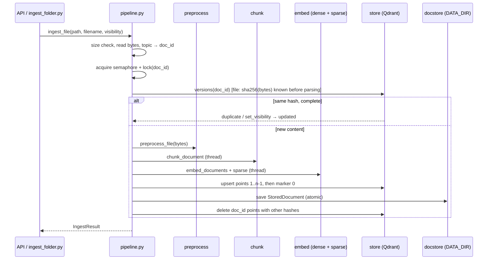

# Design Document: Ingest Pipeline

## Overview

The pipeline glues the finished stages together and adds what they deliberately left out: identity,
vectors, storage and versioning.

```python
async def ingest_file(path, filename, visibility, *, title=None, topic=None) -> IngestResult
async def ingest_url(url, visibility, *, title=None, topic=None) -> IngestResult
async def list_documents() -> list[DocumentInfo]
async def delete_document(doc_id: str) -> bool
async def corpus_version() -> str
async def init_pipeline(settings=None) -> None    # app startup: verify models, collection, reindex
async def close_pipeline() -> None
```

Flow per document: preprocess → `doc_id` from topic → per-`doc_id` lock → dedup check → chunk →
dense + sparse encode → upsert (marker point last) → save parsed JSON → delete the old version.
Every step that touches CPU runs in `asyncio.to_thread`; every Qdrant write uses `wait=True`.

The module-level functions use one lazily created `IngestPipeline` (encoders, store client,
parsed-document store, locks). The API calls `init_pipeline()` in its lifespan so model problems
fail at startup. The CLI scripts get the same instance on first use.

### Measurements that shaped the design

Taken on 2026-10-10 on the dev machine (16 logical CPUs) with the pinned model files (throw-away
scripts, nothing committed).

| Finding | Consequence |
|---|---|
| `onnx/model_quint8_avx2.onnx` @ `44399559…`: 313,421,909 bytes, sha256 `f1fdd44e…edee`. Inputs `input_ids`, `attention_mask` (int64, no `token_type_ids`); one output `last_hidden_state` `[batch, seq, 768]`. The tokenizer adds `<bos>` only. | CLS = `last_hidden_state[:, 0]`. Feed only the inputs the session declares. `max_length = chunk_max_tokens + 2` leaves room for special tokens. |
| Padded batches of different-length texts changed a vector by up to **0.012** per component (cosine 0.994 to the same text alone); same-length batches still by 0.006. The same text alone twice: identical. | Dynamic int8 quantization depends on the whole input tensor. **One sequence per `session.run`** (Req 4.3), which makes vectors independent of batching and identical for queries and documents. |
| 309-token texts: batch 16 → 5.2 chunks/s, batch 1 → 6.3 chunks/s (4 threads). Threads 2 / 4 / 8 → 3.5 / 6.3 / 6.5 chunks/s. | Batch 1 is also faster (no padding). Default `INGEST_EMBED_THREADS=4`; more threads barely help. A 400-chunk document takes about 65 s. Perf test: 32 chunks under 10 s (Req 9.5). |
| Cosine FR↔EN translation 0.984, FR↔AR 0.885, unrelated FR 0.708. | Sanity test on real vectors: translation pairs score above an unrelated sentence. |
| fastembed 0.9.0 `Bm25` always resolves a model directory (it downloads `Qdrant/bm25` unless `specific_model_path` is set), even with custom stopwords and `disable_stemmer=True`. With `specific_model_path` and `HF_HUB_OFFLINE=1` it runs offline. | Ship `arabic.txt`, `french.txt`, `english.txt` from `Qdrant/bm25` @ `22b8d2af…` into `$MODELS_DIR/bm25/` (sha256-pinned), pass it as both `specific_model_path` and `cache_dir`. |
| `Bm25` checks stopwords on the lower-cased token **before** stemming. Our input is `fold_for_search` output, so `إلى` arrives as `الي`. The union of the three lists is 1,028 words, 945 after folding. Cross-language collisions exist (`an`, `son`, `ou`). | Fold the stopword union with `fold_for_search` before passing it. Accept the collisions (EDGE_CASES row). |
| BM25 tokens per chunk on `data/parsed` (70 chunks, folded `embed_text`): mean 105, median 108, max 202. fastembed's default `avg_len` is 256. | Default `INGEST_BM25_AVG_LEN=110`, so length normalization is centred on our real chunks. |
| `AsyncQdrantClient(location=":memory:")` (qdrant-client 1.19.1) supports named dense + sparse vectors with `Modifier.IDF`, aliases, and counting through an alias. Payload indexes are accepted but ignored. | Unit and integration tests run on the in-memory client. No Docker in CI. |

## Architecture



For files the content hash (SHA-256 of the raw bytes) is known before parsing, so a duplicate upload
skips parsing and OCR entirely. For URLs the hash covers the extracted text, so the check runs after
the fetch.

### Marker point and completeness

The point with `index == 0` of each version is written **last**. Because writes are sequential and
acknowledged, a marker's presence means every point of that version is stored. Listing, the corpus
version and reindexing read only markers (`scroll` with `index == 0`, one point per version). The
duplicate check additionally counts the points of `(doc_id, content_hash)` against `chunk_count`
(Req 3.4). During a replacement a document briefly has two markers; readers keep the one with the
newest `ingested_at`.

### Collections and the alias

The physical collection is `f"{QDRANT_COLLECTION}__{index_signature()[:12]}"` and the
`QDRANT_COLLECTION` alias points to it. Retrieval and the pipeline only use the alias. A reindex
builds the new physical collection by name, then swaps the alias with one
`update_collection_aliases` call (delete + create, atomic in Qdrant) and drops the old collection.

## Components and Interfaces

| File | Responsibility | Key interface |
|---|---|---|
| `retrieval/registry.py` (new) | Pinned embedder specs, no heavy imports (also used by `download_models.py`) | `EmbedderSpec`, `EMBEDDERS: dict[str, EmbedderSpec]`, `BM25_REPO`, `BM25_REVISION`, `BM25_FILES: dict[str, str]` (file → sha256) |
| `retrieval/embed.py` (new) | Dense ONNX encoder and BM25 sparse encoder | `DenseEncoder`, `SparseEncoder` protocols; `OnnxDenseEncoder`, `Bm25SparseEncoder`; `get_dense_encoder(settings)`, `get_sparse_encoder(settings)` (cached) |
| `retrieval/store.py` (new) | Qdrant collection, alias, writes, marker reads | `VectorStore` class (below) |
| `ingest/identity.py` (new) | Pure topic and id derivation | `NAMESPACE`, `file_topic(filename)`, `url_topic(url)`, `clean_topic(topic)`, `doc_id_for(topic)`, `point_id(doc_id, content_hash, index)` |
| `ingest/docstore.py` (new) | Parsed-document JSON store | `DocStore(root)`: `save`, `load`, `delete`, `iter_all`, `set_visibility` |
| `ingest/pipeline.py` (new) | Orchestration, locks, versioning, reindex | the functions in the Overview, `IngestPipeline`, `index_signature()`, `reindex()` |
| `ingest/models.py` (extend) | Result types | `IngestResult`, `DocumentInfo`, `StoredDocument` |
| `ingest/errors.py` (extend) | New error codes | `IndexUnavailable`, `IndexStale`, `EmbeddingError`, `EmbedderConfigError` |
| `ingest/settings.py` (extend) | New `INGEST_*` fields and shared aliases | see Data Models |
| `scripts/download_models.py` (extend) | `--only embedder` (ONNX + tokenizer) and `--only bm25` | `download_embedder(dest)`, `download_bm25(dest)` |
| `scripts/ingest_folder.py` (new) | Bulk ingestion CLI | `main(argv) -> int` |
| `scripts/reindex.py` (new) | Manual reindex when startup reindex is off | `main(argv) -> int` |

### `retrieval/registry.py`

```python
@dataclass(frozen=True)
class EmbedderSpec:
    repo: str
    revision: str
    onnx_file: str          # "onnx/model_quint8_avx2.onnx"
    onnx_sha256: str
    tokenizer_sha256: str
    dim: int                # 768
    pooling: Literal["cls"]

EMBEDDERS = {"ibm-granite/granite-embedding-311m-multilingual-r2": EmbedderSpec(...)}
```

`download_models.py` imports the constants from here instead of repeating them (its existing
`EMBEDDER_REVISION` / `TOKENIZER_SHA256` move here). The later A/B models become new entries, so
switching is a config change (`EMBED_MODEL`), as AGENTS.md requires.

### `retrieval/embed.py`

```python
class DenseEncoder(Protocol):
    dim: int
    fingerprint: str                      # repo@revision:onnx_sha256
    def embed_documents(self, texts: Sequence[str]) -> list[list[float]]: ...
    def embed_query(self, text: str) -> list[float]: ...

class SparseEncoder(Protocol):
    fingerprint: str                      # SPARSE_VERSION, k, b, avg_len, stopwords sha256
    def embed_documents(self, texts: Sequence[str]) -> list[SparseVector]: ...
    def embed_query(self, text: str) -> SparseVector: ...
```

`OnnxDenseEncoder(spec, model_dir, threads, max_length)`:

- On init: check that the ONNX file exists and its sha256 matches `spec.onnx_sha256` (about 0.5 s
  for 313 MB, once per process), else `EmbedderConfigError` with the download command. Check the
  tokenizer the same way. `EMBED_DIM` must equal `spec.dim`.
- Session: `CPUExecutionProvider`, `intra_op_num_threads=threads`, `inter_op_num_threads=1`,
  graph optimizations on. Tokenizer: own `Tokenizer.from_file` with `enable_truncation(max_length)`
  and `no_padding()` (the chunker's counter keeps truncation off; this one must truncate).
- `embed_documents` loops: encode with special tokens → `[1, seq]` int64 arrays → run →
  `last_hidden_state[0, 0]` → L2 normalize (float32) → list. `embed_query` is the same function for
  one text. onnxruntime errors become `EmbeddingError` (message without text).

`Bm25SparseEncoder(model_dir, k, b, avg_len, expected=BM25_FILES)`:

- On init: check the three stopword files against `expected` (file → sha256;
  `EmbedderConfigError` otherwise; tests pass their own tiny files and hashes),
  build `stopwords = {fold_for_search(w) for w in union}`, then
  `Bm25("Qdrant/bm25", specific_model_path=dir, cache_dir=dir, disable_stemmer=True,
  stopwords=stopwords, k=k, b=b, avg_len=avg_len)`.
- `embed_documents(texts)` folds each text and calls `Bm25.embed` (no parallel workers);
  `embed_query` folds and calls `query_embed`. Results become `qdrant_client.models.SparseVector`.
- `SPARSE_VERSION = 1` is bumped by hand when folding or tokenization changes.

### `retrieval/store.py`

```python
class VectorStore:
    def __init__(self, client: AsyncQdrantClient, alias: str, dim: int): ...
    async def ensure(self, signature: str) -> Literal["ok", "created", "stale"]
    async def versions(self, doc_id: str) -> list[Version]        # markers of doc_id
    async def count(self, doc_id: str, content_hash: str) -> int
    async def upsert(self, points: Sequence[PointStruct], *, collection: str | None = None)
    async def set_visibility(self, doc_id: str, visibility: Visibility)
    async def delete_version(self, doc_id: str, content_hash: str)
    async def delete_other_versions(self, doc_id: str, keep_hash: str)
    async def delete_doc(self, doc_id: str) -> int
    async def markers(self) -> list[Marker]                        # all docs, newest per doc_id
    async def create_physical(self, signature: str) -> str
    async def switch_alias(self, physical: str)                    # atomic swap, drop old
```

- Schema: `vectors_config={"dense": VectorParams(size=dim, distance=COSINE)}`,
  `sparse_vectors_config={"bm25": SparseVectorParams(modifier=Modifier.IDF)}`. Payload indexes:
  `doc_id`, `content_hash`, `visibility` (keyword), `index` (integer).
- `ensure(signature)`: alias missing and no collection of that name → create the physical
  collection and the alias (`created`). Alias pointing to the physical name for `signature` → `ok`.
  Alias pointing elsewhere → `stale`. A real collection named like the alias →
  `EmbedderConfigError`-style startup error telling the operator to rename or drop it.
- Upserts go in batches of `INGEST_UPSERT_BATCH` (64) with `wait=True`. Filters use
  `FieldCondition(key=..., match=MatchValue(...))`; `delete_other_versions` uses `must=[doc_id]`,
  `must_not=[content_hash]`.
- Every client call is wrapped: `ResponseHandlingException`, `UnexpectedResponse`, `httpx`
  transport errors and timeouts → `IndexUnavailable`.

### `ingest/identity.py`

- `NAMESPACE = UUID("…")`: a fixed UUID committed once, never changed (changing it re-keys every
  document).
- `file_topic(filename)`: `PurePath(filename).stem`, then `clean_topic`.
- `url_topic(url)`: lower-case scheme and host, drop default port, query, fragment and trailing `/`
  (but keep `/` for the root path), then `clean_topic`.
- `clean_topic(topic)`: strip, NFC, reject empty or over 200 characters with `InvalidInput`.
- `doc_id_for(topic) -> str`: `str(uuid5(NAMESPACE, topic))`.
- `point_id(doc_id, content_hash, index) -> str`: `str(uuid5(UUID(doc_id), f"{content_hash}:{index}"))`.

### `ingest/docstore.py`

`DocStore(root=DATA_DIR / "documents")`. `save(stored)` writes `<doc_id>.json.tmp`, fsyncs, then
`os.replace`. `load(doc_id)`, `delete(doc_id)` (missing file is fine), `iter_all()` (sorted by
filename, skips `*.tmp`; an unreadable file is logged and reported to the caller, which in
`reindex()` counts as a failed document), `set_visibility(doc_id, v)` rewrites with `model_copy`.
All file I/O runs in a thread.

### `ingest/pipeline.py`

`IngestPipeline` holds the settings, `DenseEncoder`, `SparseEncoder`, `VectorStore`, `DocStore`, a
semaphore (`INGEST_MAX_CONCURRENCY`), a `WeakValueDictionary[str, asyncio.Lock]` for per-`doc_id`
locks, and a write lock taken exclusively by `reindex()` (ingests take it shared via a reader count,
so a reindex waits for running ingests and blocks new ones).

`ingest_file`:

1. Validate visibility and topic (cheap, before any I/O). `os.stat` → `FileTooLarge` above
   `max_file_bytes`. Read the bytes in a thread. `content_hash = sha256(bytes)`.
2. `doc_id = doc_id_for(topic or file_topic(filename))`. Take the semaphore, then the lock.
3. `_check_existing(doc_id, content_hash, visibility)` → `duplicate` / `updated` / `None`.
4. `doc = await preprocess_file(bytes, filename, visibility=..., title=...)`.
5. `_index(doc_id, topic, doc)` (shared with `ingest_url` and `reindex`): chunk in a thread
   (`EmptyDocument` if empty), dense then sparse in a thread, build points (payload from chunk +
   doc + `chunk_count`, `ingested_at`), upsert indexes `1..n-1`, then index `0`.
6. Save `StoredDocument`, then `delete_other_versions`. Status `created` or `replaced`.

`ingest_url` is the same from step 2 on, with `preprocess_url` first and the hash taken from the
`ParsedDocument`; the topic comes from the final URL (`doc.source`).

`_check_existing`: from `versions(doc_id)`, if a marker with this hash exists and
`count(doc_id, hash) == marker.chunk_count`: same visibility → `duplicate`; else `set_visibility`
on the store and the docstore → `updated`. An incomplete leftover with this hash is overwritten
by step 5 (same point ids).

On any exception after the first upsert of step 5: `delete_version(doc_id, content_hash)` (best
effort; its own failure is logged, the original error is raised).

`index_signature()`: sha256 of JSON `{schema: SCHEMA_VERSION, dense: dense.fingerprint,
sparse: sparse.fingerprint, chunking: chunking_signature(...)}`, computed once in `init_pipeline`.

`corpus_version()`: sha256 of `index_signature()` plus the sorted `(doc_id, content_hash,
visibility)` of `markers()`. It reads Qdrant on every call (one scroll over markers: a few ms for a
few hundred documents), so a change made by another process is seen immediately. No in-process
cache that could go stale.

`reindex()`: take the write lock, `create_physical(signature)` (drop a half-built one first), run
`_index` into it for every `StoredDocument` (same `doc_id`, visibility and `ingested_at` kept),
`switch_alias`, release. A document that fails is logged (`document_reindex_failed`) and skipped;
if any failed, the alias is **not** switched and `reindex()` raises, so search stays on the old,
complete collection.

`init_pipeline()`: build encoders (fail fast), connect, `ensure(signature)`; on `stale`, reindex if
`INGEST_REINDEX_ON_STARTUP`, else raise `IndexStale` with `uv run python scripts/reindex.py`.

## Data Models

```python
IngestStatus = Literal["created", "replaced", "duplicate", "updated"]

class IngestResult(BaseModel):          # frozen
    doc_id: str
    status: IngestStatus
    title: str
    source: str
    source_type: SourceType
    visibility: Visibility
    language: str
    chunk_count: int
    content_hash: str
    ocr_used: bool                      # False for duplicate / updated (no parse ran)
    warnings: tuple[str, ...]
    duration_ms: int

class DocumentInfo(BaseModel):          # frozen, one per complete document
    doc_id: str; title: str; source: str; source_type: SourceType; visibility: Visibility
    language: str; chunk_count: int; content_hash: str; ingested_at: datetime

class StoredDocument(BaseModel):        # DATA_DIR/documents/<doc_id>.json
    schema_version: int = 1
    doc_id: str
    topic: str
    ingested_at: datetime
    document: ParsedDocument
```

For `duplicate` and `updated` the descriptive fields come from the existing marker's payload.

Qdrant point: `id = point_id(doc_id, content_hash, index)`, vectors `{"dense": [768 floats],
"bm25": SparseVector}`, payload:

| Field | Source |
|---|---|
| `doc_id`, `content_hash`, `chunk_count`, `ingested_at` (ISO 8601 UTC) | pipeline |
| `index`, `text`, `heading_path` (list), `page_start`, `page_end`, `section_index`, `language`, `token_count` | `Chunk` |
| `visibility`, `title`, `source`, `source_type` | `ParsedDocument` |

New settings (`IngestSettings`; shared names read through `validation_alias`, as `TESSDATA_PREFIX`
already is, so `config.py` stays untouched):

| Field | Env | Default |
|---|---|---|
| `qdrant_url` | `QDRANT_URL` | `http://qdrant:6333` |
| `qdrant_collection` | `QDRANT_COLLECTION` | `mcclub` |
| `qdrant_timeout_s` | `INGEST_QDRANT_TIMEOUT_S` | 10 |
| `embed_model` | `EMBED_MODEL` | granite id (must be in `EMBEDDERS`) |
| `embed_dim` | `EMBED_DIM` | 768 (must equal the spec) |
| `models_dir` | `MODELS_DIR` | `/app/models` (embedder in `embedder/`, BM25 in `bm25/`) |
| `data_dir` | `DATA_DIR` | `/data` |
| `embed_threads` | `INGEST_EMBED_THREADS` | 4 |
| `embed_max_length` | `INGEST_EMBED_MAX_LENGTH` | 512 (validated `>= chunk_max_tokens + 2`) |
| `bm25_k`, `bm25_b`, `bm25_avg_len` | `INGEST_BM25_*` | 1.2, 0.75, 110 |
| `upsert_batch` | `INGEST_UPSERT_BATCH` | 64 |
| `reindex_on_startup` | `INGEST_REINDEX_ON_STARTUP` | true |

## Error Handling

| Situation | Behavior |
|---|---|
| Bad visibility / topic | `InvalidInput` before any I/O |
| File over the limit | `FileTooLarge` from `os.stat`, file not read |
| Preprocessing errors | propagate unchanged (existing codes) |
| No chunks | `EmptyDocument` |
| ONNX / tokenizer / stopword file missing or wrong sha256, `EMBED_MODEL` unknown, `EMBED_DIM` mismatch | `EmbedderConfigError` at startup, message names the path and the `download_models.py` command |
| onnxruntime fails at inference | `EmbeddingError`; partial points deleted |
| Qdrant down, timeout, rejected write | `IndexUnavailable` (suggested 503); partial points deleted best effort; previous version untouched |
| Alias points to another signature, startup reindex off | `IndexStale` at startup |
| Reindex: one stored document fails | logged, alias not switched, `reindex()` raises |
| Crash between upsert and docstore save | the index holds the new version, the JSON the old one, so a reindex would bring back the old one. Accepted and listed in EDGE_CASES; the next ingest of that document repairs it |
| Crash leaves points without a marker | invisible to listing and the corpus version but searchable until the next ingest of that `doc_id` (which deletes other hashes) or a reindex. Accepted, in EDGE_CASES |

New error classes join `ALL_ERRORS`; suggested HTTP mapping for eequaled: `index_unavailable` 503,
`embedding_error` 500, startup codes have none.

Logging (structlog): `document_ingested` (doc_id, status, chunks, `ms_preprocess`, `ms_chunk`,
`ms_dense`, `ms_sparse`, `ms_store`, `duration_ms`, source without query string),
`document_ingest_failed` (doc_id if known, code, stage), `document_deleted`, `reindex_started` /
`reindex_finished` (documents, chunks, duration). Never text, never the topic of a URL with its query.

## Testing Strategy

Unit tests use fakes: a `FakeDenseEncoder` (deterministic vectors from a hash of the text, 8 dims)
and the real `Bm25SparseEncoder` with tiny stopword files written to `tmp_path` (their hashes
passed as `expected`), plus `AsyncQdrantClient(":memory:")` and a `tmp_path`
docstore. Real-model tests get a new `embedder` marker, auto-applied to tests that use an
`onnx_path` fixture, and fail with the download instruction when the file is missing (same pattern
as `ocr`).

| Test file | Covers |
|---|---|
| `tests/test_identity.py` | topic rules, URL normalization cases, stable `doc_id` (golden UUIDs), point ids differ across hashes (Req 2) |
| `tests/test_docstore.py` | atomic save/load round trip of a `ParsedDocument` with sections, delete, visibility rewrite, tmp files ignored (Req 7.2, 7.3) |
| `tests/test_embed.py` | sparse: folding makes `الإنتخابات` match `الانتخابات` and `règlement` match `reglement`, stopwords dropped after folding, missing file → `EmbedderConfigError`; dense config errors with a fake file (Req 4.4, 5) |
| `tests/test_embed_model.py` (`embedder`) | shape 768, unit norm, alone vs inside a list identical (1e-4), `embed_query == embed_documents([x])[0]`, translation pair above unrelated, sha check, perf: 32 × 300-token chunks dense + sparse < 10 s on 4 threads (Req 4.1–4.3, 4.6, 9.5) |
| `tests/test_store.py` | schema created, `ensure` ok / created / stale / name clash, markers newest wins, delete other versions, set visibility, alias switch keeps search working, transport errors → `IndexUnavailable` (Req 6, 8.3) |
| `tests/test_pipeline.py` | created → duplicate → updated → replaced sequence; no moment with zero points (store spy); crashed half-ingest is not duplicate; concurrent same-`doc_id` ingests serialized; failure after partial upsert cleans up and keeps the old version; duplicate file skips preprocessing (spy); empty doc; size check before read; logging has no text (Req 1, 3, 9) |
| `tests/test_corpus_version.py` | changes on create/replace/update/delete, stable otherwise, equal across two pipeline instances on the same store, changes with chunking settings (Req 8.1, 8.2) |
| `tests/test_reindex.py` | signature change → rebuild from docstore without preprocessing (spy), alias swapped, old collection dropped; a failing document leaves the alias alone; startup with reindex off → `IndexStale` (Req 8.3, 8.4) |
| `tests/test_ingest_folder.py` | two runs: second all `duplicate`, exit code non-zero when one file fails (Req 10) |
| `tests/test_download_models.py` (extend) | `--only embedder` / `--only bm25` with a mocked transport, sha mismatch fails (Req 4.5, 5.3) |

CI: the models job adds `--only embedder --only bm25` (cached by revision with `actions/cache`) and
runs `pytest -m "ocr or tokenizer or embedder"`; the fast job excludes `embedder` too.

## Traceability

| Requirement | Design |
|---|---|
| 1 Entry points | Overview, `ingest/pipeline.py`, `IngestResult` |
| 2 Identity | `ingest/identity.py` |
| 3 Dedup / replace | marker point, `_check_existing`, per-`doc_id` locks, upsert order |
| 4 Dense | `OnnxDenseEncoder`, `registry.py`, measurements |
| 5 Sparse | `Bm25SparseEncoder`, folded stopwords, IDF modifier |
| 6 Collection | `VectorStore`, payload table |
| 7 Docstore, list, delete | `ingest/docstore.py`, `markers()`, `delete_doc` |
| 8 Versioning | `index_signature`, `corpus_version`, alias, `reindex`, `init_pipeline` |
| 9 Errors, ops | Error Handling, semaphore, threads, logging, perf test |
| 10 Bulk | `scripts/ingest_folder.py` |

## Open questions

- Same as the requirements (seam approval with eequaled, raw uploads, blocking startup reindex).
- `inter_op_num_threads=1` and one session per process: if chat queries and an ingest embed at the
  same time, they share the session (onnxruntime `run` is thread-safe) and slow each other down.
  Fine at club scale; revisit if chat latency suffers during uploads.
