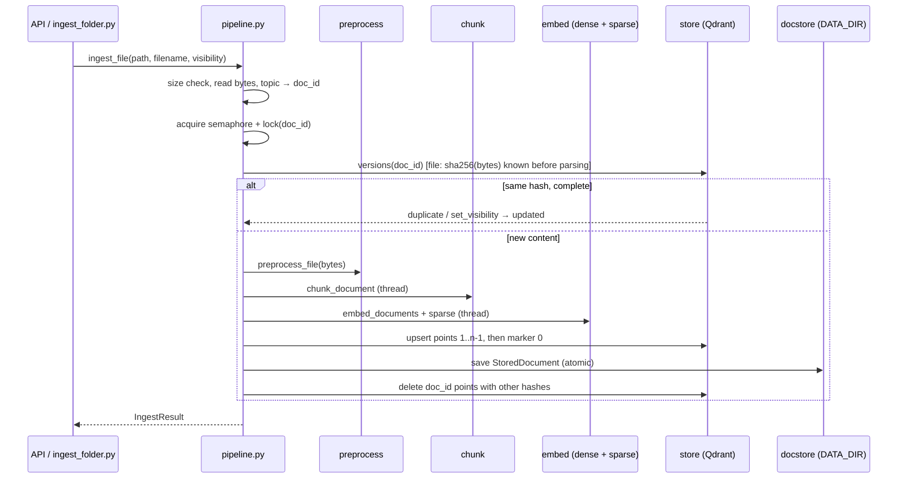

# Design Document: Ingest Pipeline

## Overview

The pipeline glues the finished stages together and adds what they deliberately left out: identity,
vectors, storage and versioning.

```python
async def ingest_file(path, filename, visibility, *, title=None, topic=None) -> IngestResult
async def ingest_url(url, visibility, *, title=None, topic=None) -> IngestResult
async def list_documents() -> list[DocumentInfo]
async def delete_document(doc_id: str) -> bool
async def corpus_version() -> str
async def init_pipeline(settings=None) -> None    # app startup: verify models, collection, reindex
async def close_pipeline() -> None
```

Flow per document: preprocess → `doc_id` from topic → per-`doc_id` lock → dedup check → chunk →
dense + sparse encode → upsert (marker point last) → save parsed JSON → delete the old version.
Every step that touches CPU runs in `asyncio.to_thread`; every Qdrant write uses `wait=True`.

The module-level functions use one lazily created `IngestPipeline` (encoders, store client,
parsed-document store, locks). The API calls `init_pipeline()` in its lifespan so model problems
fail at startup. The CLI scripts get the same instance on first use.

### Measurements that shaped the design

Taken on 2026-10-10 on the dev machine (16 logical CPUs) with the pinned model files (throw-away
scripts, nothing committed).

| Finding | Consequence |
|---|---|
| `onnx/model_quint8_avx2.onnx` @ `44399559…`: 313,421,909 bytes, sha256 `f1fdd44e…edee`. Inputs `input_ids`, `attention_mask` (int64, no `token_type_ids`); one output `last_hidden_state` `[batch, seq, 768]`. The tokenizer adds `<bos>` only. | CLS = `last_hidden_state[:, 0]`. Feed only the inputs the session declares. `max_length = chunk_max_tokens + 2` leaves room for special tokens. |
| Padded batches of different-length texts changed a vector by up to **0.012** per component (cosine 0.994 to the same text alone); same-length batches still by 0.006. The same text alone twice: identical. | Dynamic int8 quantization depends on the whole input tensor. **One sequence per `session.run`** (Req 4.3), which makes vectors independent of batching and identical for queries and documents. |
| 309-token texts: batch 16 → 5.2 chunks/s, batch 1 → 6.3 chunks/s (4 threads). Threads 2 / 4 / 8 → 3.5 / 6.3 / 6.5 chunks/s. | Batch 1 is also faster (no padding). Default `INGEST_EMBED_THREADS=4`; more threads barely help. A 400-chunk document takes about 65 s. Perf test: 32 chunks under 10 s (Req 9.5). |
| Cosine FR↔EN translation 0.984, FR↔AR 0.885, unrelated FR 0.708. | Sanity test on real vectors: translation pairs score above an unrelated sentence. |
| fastembed 0.9.0 `Bm25` always resolves a model directory (it downloads `Qdrant/bm25` unless `specific_model_path` is set), even with custom stopwords and `disable_stemmer=True`. With `specific_model_path` and `HF_HUB_OFFLINE=1` it runs offline. | Ship `arabic.txt`, `french.txt`, `english.txt` from `Qdrant/bm25` @ `22b8d2af…` into `$MODELS_DIR/bm25/` (sha256-pinned), pass it as both `specific_model_path` and `cache_dir`. |
| `Bm25` checks stopwords on the lower-cased token **before** stemming. Our input is `fold_for_search` output, so `إلى` arrives as `الي`. The union of the three lists is 1,028 words, 945 after folding. Cross-language collisions exist (`an`, `son`, `ou`). | Fold the stopword union with `fold_for_search` before passing it. Accept the collisions (EDGE_CASES row). |
| BM25 tokens per chunk on `data/parsed` (70 chunks, folded `embed_text`): mean 105, median 108, max 202. fastembed's default `avg_len` is 256. | Default `INGEST_BM25_AVG_LEN=110`, so length normalization is centred on our real chunks. |
| `AsyncQdrantClient(location=":memory:")` (qdrant-client 1.19.1) supports named dense + sparse vectors with `Modifier.IDF`, aliases, and counting through an alias. Payload indexes are accepted but ignored. | Unit and integration tests run on the in-memory client. No Docker in CI. |

## Architecture



For files the content hash (SHA-256 of the raw bytes) is known before parsing, so a duplicate upload
skips parsing and OCR entirely. For URLs the hash covers the extracted text, so the check runs after
the fetch.

### Marker point and completeness

The point with `index == 0` of each version is written **last**. Because writes are sequential and
acknowledged, a marker's presence means every point of that version is stored. Listing, the corpus
version and reindexing read only markers (`scroll` with `index == 0`, one point per version). The
duplicate check additionally counts the points of `(doc_id, content_hash)` against `chunk_count`
(Req 3.4). During a replacement a document briefly has two markers; readers keep the one with the
newest `ingested_at`.

### Collections and the alias

The physical collection is `f"{QDRANT_COLLECTION}__{index_signature()[:12]}"` and the
`QDRANT_COLLECTION` alias points to it. Retrieval and the pipeline only use the alias. A reindex
builds the new physical collection by name, then swaps the alias with one
`update_collection_aliases` call (delete + create, atomic in Qdrant) and drops the old collection.

## Components and Interfaces

| File | Responsibility | Key interface |
|---|---|---|
| `retrieval/registry.py` (new) | Pinned embedder specs, no heavy imports (also used by `download_models.py`) | `EmbedderSpec`, `EMBEDDERS: dict[str, EmbedderSpec]`, `BM25_REPO`, `BM25_REVISION`, `BM25_FILES: dict[str, str]` (file → sha256) |
| `retrieval/embed.py` (new) | Dense ONNX encoder and BM25 sparse encoder | `DenseEncoder`, `SparseEncoder` protocols; `OnnxDenseEncoder`, `Bm25SparseEncoder`; `get_dense_encoder(settings)`, `get_sparse_encoder(settings)` (cached) |
| `retrieval/store.py` (new) | Qdrant collection, alias, writes, marker reads | `VectorStore` class (below) |
| `ingest/identity.py` (new) | Pure topic and id derivation | `NAMESPACE`, `file_topic(filename)`, `url_topic(url)`, `clean_topic(topic)`, `doc_id_for(topic)`, `point_id(doc_id, content_hash, index)` |
| `ingest/docstore.py` (new) | Parsed-document JSON store | `DocStore(root)`: `save`, `load`, `delete`, `iter_all`, `set_visibility` |
| `ingest/pipeline.py` (new) | Orchestration, locks, versioning, reindex | the functions in the Overview, `IngestPipeline`, `index_signature()`, `reindex()` |
| `ingest/models.py` (extend) | Result types | `IngestResult`, `DocumentInfo`, `StoredDocument` |
| `ingest/errors.py` (extend) | New error codes | `IndexUnavailable`, `IndexStale`, `EmbeddingError`, `EmbedderConfigError` |
| `ingest/settings.py` (extend) | New `INGEST_*` fields and shared aliases | see Data Models |
| `scripts/download_models.py` (extend) | `--only embedder` (ONNX + tokenizer) and `--only bm25` | `download_embedder(dest)`, `download_bm25(dest)` |
| `scripts/ingest_folder.py` (new) | Bulk ingestion CLI | `main(argv) -> int` |
| `scripts/reindex.py` (new) | Manual reindex when startup reindex is off | `main(argv) -> int` |

### `retrieval/registry.py`

```python
@dataclass(frozen=True)
class EmbedderSpec:
    repo: str
    revision: str
    onnx_file: str          # "onnx/model_quint8_avx2.onnx"
    onnx_sha256: str
    tokenizer_sha256: str
    dim: int                # 768
    pooling: Literal["cls"]

EMBEDDERS = {"ibm-granite/granite-embedding-311m-multilingual-r2": EmbedderSpec(...)}
```

`download_models.py` imports the constants from here instead of repeating them (its existing
`EMBEDDER_REVISION` / `TOKENIZER_SHA256` move here). The later A/B models become new entries, so
switching is a config change (`EMBED_MODEL`), as AGENTS.md requires.

