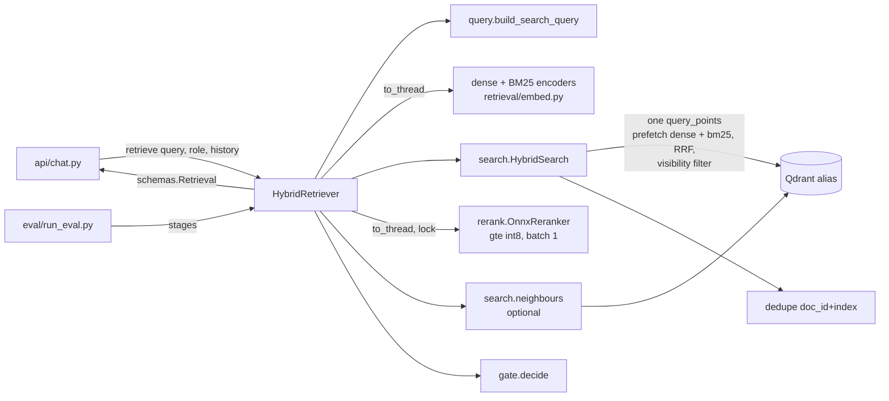

# Design Document

## Overview

`HybridRetriever` implements eequaled's `RetrievalBackend` protocol. One `retrieve()` call:

1. builds the search query (the message, or previous user message + message for a short
   follow-up);
2. encodes it with the ingest encoders (dense granite, BM25) off the event loop;
3. sends **one** Qdrant `query_points` to the `QDRANT_COLLECTION` alias: two prefetches (dense,
   bm25), fused server-side (RRF), with the role's visibility filter on every level;
4. dedupes candidates by `(doc_id, index)`, keeping the newest `ingested_at`;
5. reranks them with gte-multilingual-reranker-base int8, one pair per `session.run`;
6. keeps the best `RERANK_TOP_N`, optionally adds `index ± 1` neighbours to their text;
7. applies the gate (`top_score < GATE_THRESHOLD` -> `refuse`) and returns `schemas.Retrieval`.

No LLM call, no network besides Qdrant. The eval harness drives the same object stage by stage,
so what it measures is what the API runs.

### Measurements behind the choices (2026-10-10)

Dev machine, 16 cores, onnxruntime CPU EP, 30 passages cut from `data/parsed` (Arabic, French,
English), queries in ar/fr/en, script kept as `eval/bench_rerank.py`.

| Measurement | Result | Decision |
|---|---|---|
| gte int8, 30 pairs of ~384 tokens, batch 1: 2 / 4 / 8 threads | 5.8 / **3.3** / 2.7 s (110 ms/pair at 4) | Default 4 threads (shared with ingest's 4); the candidate count is the latency knob (Req 9). |
| bge int8, same, 4 / 8 threads | 7.7 / 6.8 s (256 ms/pair) | 2.3x slower: A/B only (decided). |
| ~500-token passages, 4 threads | gte 4.2 s, bge 10.1 s | Cost grows with length; chunks are ~300 granite tokens (~384 reranker tokens). |
| Batches of 8 / 30 (padded) vs batch 1 | gte 5.1 to 5.5 s vs 4.4 s; bge 10.9 to 11.2 s vs 10.1 s | Batching is slower on CPU. |
| Score of the same pair, batched vs alone | gte up to **1.80 logits**, bge up to 1.00; a short pair padded among long ones moved 0.08 to 0.35 | Dynamic int8 quantizes per input tensor (as with granite, where it was 0.012). **One pair per run** (Req 4.3), else the gate threshold would depend on the other candidates. |
| Same pair alone twice | identical | Deterministic (Req 4.4). |
| RSS with batch 1 | gte 0.9 GB, bge 1.1 GB (batch 30: 3.6 to 4.0 GB) | Batch 1 also bounds memory. |
| gte raw logits on unrelated passages | -3.3 to 0.4 (bge -11 to -0.8) | Ranges differ per model: report sigmoid (Req 1.3). |
| gte `tokenizer.json` | ships fixed-length padding enabled; pair = `<s> q </s></s> p </s>` | Call `no_padding()`; truncate `only_second`. |
| gte ONNX inputs | `input_ids`, `attention_mask`, `token_type_ids` (bge: no `token_type_ids`) | Feed only the inputs the session declares (as `OnnxDenseEncoder` does). |
| Qdrant 1.19.2 server, filter only at the top level, 19 members points ranked above the 1 public point on both arms, prefetch limit 3 | public role got the public point | The server pushes the filter into prefetches before their limits; we still set it on each prefetch too (explicit, and the local test mode does the same). |
| qdrant-client RRF default `k` | `DEFAULT_RANKING_CONSTANT_K = 2` (server same) | `k` is a setting; default 60 (the usual value), eval compares 2 / 60. |

## Architecture



Concurrency: encoders and reranker run in `asyncio.to_thread`. An `asyncio.Lock` around the
rerank stage keeps one rerank per process (Req 4.6); a second chat waits instead of halving both
requests' speed. Ingest embedding can still run in parallel (accepted: club scale; see risks).

## Components and Interfaces

### `retrieval/settings.py`: `RetrievalSettings`

Separate pydantic-settings class (like `IngestSettings`), `env_prefix="RETRIEVAL_"`, so
`config.py` stays eequaled's. Shared names are read through aliases with the same defaults as
`config.py`, except the reranker (decided):

| Field | Env | Default |
|---|---|---|
| `top_k` | `RETRIEVE_TOP_K` | 30 (eval proposes a new value) |
| `top_n` | `RERANK_TOP_N` | 5 |
| `gate_threshold` | `GATE_THRESHOLD` (blank = None) | None |
| `rerank_model` | `RERANK_MODEL` | `Alibaba-NLP/gte-multilingual-reranker-base` |
| `models_dir`, `qdrant_collection` | `MODELS_DIR`, `QDRANT_COLLECTION` | as ingest |
| `fusion` | `RETRIEVAL_FUSION` | `rrf` (`rrf` or `dbsf`) |
| `rrf_k` | `RETRIEVAL_RRF_K` | 60 |
| `dense_weight`, `sparse_weight` | `RETRIEVAL_DENSE_WEIGHT`, `..._SPARSE_WEIGHT` | 1.0, 1.0 (RRF only) |
| `prefetch_limit` | `RETRIEVAL_PREFETCH_LIMIT` | 40 per arm (>= `top_k`, validated) |
| `rerank_max_length` | `RETRIEVAL_RERANK_MAX_LENGTH` | 640 (>= 640, validated) |
| `rerank_threads` | `RETRIEVAL_RERANK_THREADS` | 4 |
| `followup_max_words` | `RETRIEVAL_FOLLOWUP_MAX_WORDS` | 8 |
| `neighbours` | `RETRIEVAL_NEIGHBOURS` | false |

Equal weights use plain `FusionQuery(RRF)` semantics through `RrfQuery(Rrf(k, weights=None))`;
unequal weights pass `weights=[dense, sparse]`.

### `retrieval/query.py`

```python
def build_search_query(message: str, history: Sequence[object], max_words: int) -> tuple[str, bool]:
    """(query, used_history). Pure."""
```

Strips the message (NFC, whitespace collapsed via `text.normalize`). If `history` is non-empty, its
last item is a `Turn` (duck-typed: has a str `user_message`) and the message has fewer than
`max_words` whitespace words, returns `f"{last.user_message}\n{message}"`. Used for both the search
and the rerank query: the reranker must see the same intent the search used. Only the previous
turn: with `_MAX_TURNS = 3`, going further back drifts to old topics.

### `retrieval/search.py`

```python
@dataclass(frozen=True)
class Candidate:
    point_id: str
    doc_id: str
    content_hash: str
    index: int
    title: str
    heading_path: tuple[str, ...]
    text: str
    visibility: str
    ingested_at: datetime
    fused_score: float
    fused_rank: int

def visibility_filter(role: Role) -> qm.Filter       # ValueError on unknown role
def dedupe(candidates: Sequence[Candidate]) -> list[Candidate]   # pure, keeps fused order

class HybridSearch:
    def __init__(self, client: AsyncQdrantClient, alias: str, settings: RetrievalSettings): ...
    async def search(self, dense: list[float], sparse: SparseVector, role: Role) -> list[Candidate]
    async def neighbours(self, hits: Sequence[Candidate], role: Role) -> dict[tuple[str, str, int], str]
```

- `search`: `query_points(alias, prefetch=[Prefetch(dense, using="dense", limit=prefetch_limit,
  filter=f), Prefetch(sparse, using="bm25", limit=..., filter=f)], query=RrfQuery|FusionQuery(DBSF),
  query_filter=f, limit=top_k, with_payload=[...needed fields], with_vectors=False)`, then `dedupe`.
- `visibility_filter`: public -> `MatchValue("public")`; member -> `MatchAny(["public","members"])`.
- `dedupe`: group by `(doc_id, index)`, keep max `ingested_at` (tie: better fused rank), return in
  fused order.
- `neighbours`: one `scroll` with `should` = one `must[doc_id, content_hash, index ∈ {i-1, i+1}]`
  per hit, plus the visibility filter; returns text by `(doc_id, content_hash, index)`.
- Qdrant errors (`ApiException`, `httpx.HTTPError`, `TimeoutError`) -> `IndexUnavailable`, reusing
  `store._guard` (moved to a public `store.guard`).

### `retrieval/rerank.py`

```python
class Reranker(Protocol):
    @property
    def fingerprint(self) -> str: ...
    def score(self, query: str, passages: Sequence[str]) -> list[float]: ...   # sigmoid, 0..1

def passage(title: str, heading_path: Sequence[str], text: str) -> str
class OnnxReranker:  # (spec, model_dir, *, threads, max_length, session=None)
def get_reranker(settings: RetrievalSettings) -> OnnxReranker   # lru_cache per config
```

- `passage`: `" > ".join` of title + heading path without consecutive repeats, `"\n\n"`, text:
  the header the chunk was embedded with (`ingest/chunk.py::_header`) minus its 48-token trim,
  which `only_second` truncation makes unnecessary. With `INGEST_CHUNK_CONTEXT_HEADER=false` the
  passage is the text alone, matching what was embedded (the eval's header on/off variant).
- `OnnxReranker`: checks tokenizer + ONNX sha256 (reusing `embed._check_file`, group `reranker`)
  -> `RerankerConfigError`; `tokenizer.no_padding()`, `enable_truncation(max_length,
  strategy="only_second")`; one `session.run` per pair with `input_ids`, `attention_mask`, and
  `token_type_ids` (zeros) if declared; `sigmoid(logit)`. onnxruntime errors -> `RerankError`.
- `registry.py`: `RerankerSpec(repo, revision, onnx_file, onnx_sha256, tokenizer_sha256)`;
  `RERANKERS` keyed by the original model name **and** the onnx-community repo name:

| Key(s) | Repo @ revision | File | sha256 |
|---|---|---|---|
| `Alibaba-NLP/gte-multilingual-reranker-base`, `onnx-community/gte-multilingual-reranker-base` | `onnx-community/gte-multilingual-reranker-base` @ `ee64367e35a2db0da46bb6497e13a18f8bd585cb` | `onnx/model_int8.onnx` (340,858,200 B) | `ccf51dba7f8aa920…3c7c35`; tokenizer `3ffb37461c391f09…022e98` |
| `BAAI/bge-reranker-v2-m3`, `onnx-community/bge-reranker-v2-m3-ONNX` | `onnx-community/bge-reranker-v2-m3-ONNX` @ `6f5ff65298512715a1e669753bc754d2bc8f367b` | `onnx/model_int8.onnx` (570,727,094 B) | `912fc1215c2dbff6…6cce5d`; tokenizer `8bf8afbfd11306bd…48d3` |

  (Full hashes go in the code.) Mapping `BAAI/bge-reranker-v2-m3` keeps `config.py`'s default
  name valid.
- Files live in `$MODELS_DIR/reranker/<spec slug>/`, so both can be on disk for the A/B.
- `scripts/download_models.py --only reranker [--model NAME]`: default `RERANK_MODEL` or gte;
  included in "all", so the Dockerfile's plain call bakes gte into the image.

### `retrieval/gate.py`

```python
def decide(scores: Sequence[float], threshold: float | None) -> tuple[float, RetrieveDecision]:
    """(top_score, decision). Pure."""
```

Empty -> `(0.0, "refuse")`; threshold None -> `"answer"`; else `top < threshold` -> `"refuse"`.

### `retrieval/backend.py`: `HybridRetriever`

```python
class HybridRetriever:
    def __init__(self, settings: RetrievalSettings, *, dense: DenseEncoder, sparse: SparseEncoder,
                 client: AsyncQdrantClient, reranker: Reranker): ...
    @classmethod
    def from_pipeline(cls, pipeline: IngestPipeline, settings: RetrievalSettings | None = None,
                      reranker: Reranker | None = None) -> "HybridRetriever"
    async def retrieve(self, query: str, role: Role, history: list[object]) -> Retrieval
    # stages, public for the eval harness:
    async def candidates(self, query: str, role: Role) -> list[Candidate]
    async def rerank(self, query: str, candidates: Sequence[Candidate]) -> list[tuple[Candidate, float]]
```

`from_pipeline` reuses the pipeline's encoders, `AsyncQdrantClient` and alias, so ingest and
retrieval share one client and the same model sessions. At construction it logs
`retrieval_gate_open` once if `gate_threshold is None` (Req 5.4). Building `Chunk`s:
`chunk_id=point_id`, `title=doc title`, `text` = chunk text (or neighbour-joined),
`score=rerank score`. Wiring into `main.py`'s `ApplicationState.retrieval` is eequaled's file and
done together with the `DocumentBackend` adapter (out of scope here).

## Data Models

- **Read payload** (written by `ingest/pipeline.py::_payload`): `doc_id`, `content_hash`, `index`,
  `text`, `title`, `heading_path`, `visibility`, `ingested_at` are fetched; nothing is written.
- **Output:** `schemas.Retrieval` / `schemas.Chunk` unchanged.
- **`eval/questions.jsonl`** (one JSON object per line):

```json
{"id": "ar-03", "question": "...", "lang": "ar", "role": "member", "answerable": true,
 "doc": "www.bbc.com_arabic", "evidence": ["..."], "tags": ["arabic"],
 "history": [{"user_message": "...", "assistant_message": "..."}]}
```

  `doc` is the topic (filename stem) from `eval/corpus.json`; `evidence` are short verbatim
  strings (compared after `fold_for_search` on both sides, so tatweel/diacritics/case don't break
  a hit). Unanswerable: `answerable=false`, no `doc`. Access checks: tag `access`, role `public`,
  `answerable=false` (the doc exists but is members-only).
- **`eval/corpus.json`:** `[{"file": "...md", "visibility": "public"|"members", "topic": "..."}]`
  for the corpus directory (default `data/parsed`, the 4 current files; read-only input).
- **`eval/results/<UTC timestamp>-<label>.json`:** settings (retrieval + chunking + model
  fingerprints), corpus version, per-question rows (ranks before/after rerank, top_score,
  decision, ms per stage), aggregates per tag, the threshold sweep.

## Evaluation harness (`eval/run_eval.py`)

```
uv run python eval/run_eval.py [--corpus data/parsed] [--label gte-k20] [--max-false-refusal 0.05]
RETRIEVE_TOP_K=20 RETRIEVAL_RRF_K=2 INGEST_CHUNK_TARGET_TOKENS=200 uv run python eval/run_eval.py
```

1. Build `IngestSettings` / `RetrievalSettings` from the environment, an in-memory Qdrant, the real
   encoders and reranker; ingest the corpus with `IngestPipeline` (about 12 s for 70 chunks).
2. For each question: `build_search_query` -> `candidates()` (record fused ranks, ms) ->
   `rerank()` (record ranks, scores, ms). Rank lists go to depth 10 (`top_n` raised to 10 inside
   the harness), hit@5 counts the first 5.
3. Hit = a chunk with the expected `doc` whose folded text contains a folded evidence string.
   Metrics: hit@5 and MRR@10, pre- and post-rerank, overall and per tag; access violations (any
   members chunk for a public question) counted separately and must be 0.
4. Gate sweep over thresholds 0.00 to 1.00 step 0.01 on post-rerank `top_score`: refused share of
   unanswerable, wrongly refused share of answerable. Suggested threshold = the highest one whose
   false-refusal share is <= `--max-false-refusal` (a wrong refusal loses a real answer; a missed
   refusal only costs one LLM call, which can still say "I don't know").
5. Latency: median / p95 per stage and total; prints a table and writes the JSON result.

With ~40 questions the threshold is coarse; the JSON keeps raw scores so it can be recalibrated
when the corpus and question set grow. `eval/bench_rerank.py` keeps the latency / batch probe
from this spec reproducible.

## Error Handling

| Failure | Behaviour |
|---|---|
| Empty query after normalisation | `Retrieval([], 0.0, "refuse")`, no Qdrant or model call (Req 1.5). |
| Unknown role | `ValueError` (a programming error, not a user error). |
| Qdrant down / API error / timeout | `IndexUnavailable` (`index_unavailable`). |
| Encoder failure | `EmbeddingError` (existing). |
| Reranker run failure | new `RerankError` (`rerank_error`). No fallback to fused order: a silent fallback would make the gate compare non-reranker scores to a reranker threshold. |
| Reranker files missing / bad sha256 | new `RerankerConfigError` (`reranker_config_error`) at construction, with the download command. |
| Collection empty / no candidates | `Retrieval([], 0.0, "refuse")`. |
| Duplicate versions in candidates | `dedupe` (Req 3). |

**Seam gap (needs eequaled):** `api/chat.py` lets exceptions propagate, and the app's handler
catches `mcclub_rag.errors.IngestError`, a different class from our `ingest.errors.IngestError`;
its status map has no `index_unavailable` / `embedding_error` / `rerank_error`. As is, a Qdrant
outage during chat becomes the generic 500 handler. Proposal for the wiring task: the app handler
also catches `ingest.errors.IngestError` (same `code`/`message` attributes) and maps
`index_unavailable` -> 503 and `embedding_error` / `rerank_error` -> 500. Nothing in this spec
depends on it; it is listed so the wiring PR does not forget it.

## Testing Strategy

- **Unit, no models, no Docker** (`AsyncQdrantClient(":memory:")`, `tests/pipeline_helpers.py`
  fake dense encoder + tiny-stopword BM25, a `FakeReranker` scoring by keyword overlap and a fake
  ONNX session for `OnnxReranker`):
  - `query.py`: empty history, short follow-up, long message, non-`Turn` history items.
  - `gate.py`: empty, None threshold, below/at/above threshold.
  - `search.py`: `visibility_filter` for both roles and unknown role; `dedupe` keeps newest and
    fused order; members-only chunks that score higher on both arms never reach a public role
    (Req 11.3); prefetch limit / top_k respected; RRF weights passed.
  - `rerank.py`: `passage` header building; sha256 / missing-file errors; one `run` per pair
    (fake session counts calls and batch sizes); `token_type_ids` only when declared; sigmoid;
    onnxruntime error -> `RerankError`.
  - `backend.py`: full `retrieve()` over ingested fake docs: ordering by rerank score, top_n cut,
    `top_score`, gate refuse/answer, empty query, follow-up uses history, neighbours on/off
    (text joined, ids/scores unchanged, no cross-visibility neighbour), Qdrant failure ->
    `IndexUnavailable`, one `retrieval_done` log without query text.
  - `eval/run_eval.py` metric functions (hit@k, MRR, sweep, suggestion) as pure functions, plus
    a `questions.jsonl` schema/coverage test (counts per tag, docs exist in `corpus.json`).
- **Model tests, marker `reranker`** (fixture `reranker_dir`, auto-marked in `conftest.py` like
  `onnx_path`): real gte scores a relevant passage above an unrelated one in ar, fr and en; a
  pair scores identically alone and after other pairs (batch independence by construction);
  30 x ~384-token pairs under 10 s (CI runner ~2x slower than 3.3 s).
- **CI:** the models job adds `download_models.py --only reranker --dest models/reranker`
  (cache keyed on `registry.py`) and runs `-m "ocr or tokenizer or embedder or reranker"`; the
  fast job excludes `reranker`.
- **Eval** is not part of `pytest`; it is run by hand and its JSON committed under `eval/results/`.

## Requirements traceability

| Req | Where |
|---|---|
| 1 Contract | `backend.HybridRetriever.retrieve`, `gate.decide`, sigmoid in `rerank` |
| 2 Hybrid + filter | `search.HybridSearch.search`, `visibility_filter`, `to_thread` in backend |
| 3 Dedupe | `search.dedupe` before `rerank` |
| 4 Rerank | `rerank.OnnxReranker`, `passage`, `registry.RERANKERS`, lock in backend |
| 5 Gate | `gate.decide`, startup warning in backend |
| 6 Follow-ups | `query.build_search_query` |
| 7 Neighbours | `search.HybridSearch.neighbours`, `RETRIEVAL_NEIGHBOURS` |
| 8 Errors / logs | Error Handling table, `retrieval_done` event |
| 9 Performance | measurements above, `RETRIEVE_TOP_K` / threads settings, eval latency report |
| 10 Eval | `eval/questions.jsonl`, `eval/corpus.json`, `eval/run_eval.py`, `eval/bench_rerank.py` |
| 11 Tests | Testing Strategy |

## Risks and accepted limits

- **Ingest and chat share CPU.** A big upload (6 chunks/s for a minute) slows a concurrent chat's
  rerank. Accepted at club scale; revisit with a shared CPU semaphore if it shows in logs.
- **First request after start** pays ONNX session warm-up (~0.3 s gte load + first run); the
  backend runs one dummy pair at construction.
- **40 questions** calibrate the gate coarsely; documented above, recalibrate as the set grows.
- **Follow-up heuristic** (word count) misses long follow-ups that still depend on context
  ("what does the second candidate say about the budget in his programme?"); measured by the
  `follow_up` tag, accepted under the 1-LLM-call rule.
