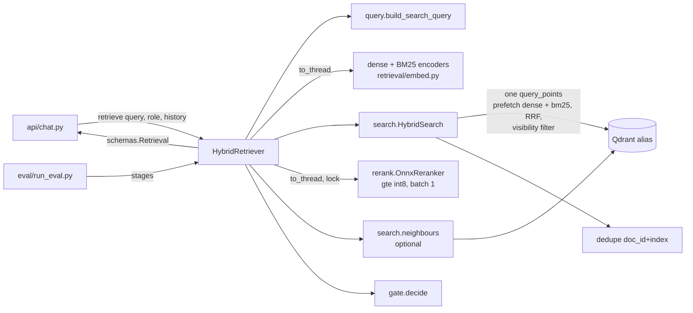

# Design Document

## Overview

`HybridRetriever` implements eequaled's `RetrievalBackend` protocol. One `retrieve()` call:

1. builds the search query (the message, or previous user message + message for a short
   follow-up);
2. encodes it with the ingest encoders (dense granite, BM25) off the event loop;
3. sends **one** Qdrant `query_points` to the `QDRANT_COLLECTION` alias: two prefetches (dense,
   bm25), fused server-side (RRF), with the role's visibility filter on every level;
4. dedupes candidates by `(doc_id, index)`, keeping the newest `ingested_at`;
5. reranks them with gte-multilingual-reranker-base int8, one pair per `session.run`;
6. keeps the best `RERANK_TOP_N`, optionally adds `index ± 1` neighbours to their text;
7. applies the gate (`top_score < GATE_THRESHOLD` -> `refuse`) and returns `schemas.Retrieval`.

No LLM call, no network besides Qdrant. The eval harness drives the same object stage by stage,
so what it measures is what the API runs.

### Measurements behind the choices (2026-10-10)

Dev machine, 16 cores, onnxruntime CPU EP, 30 passages cut from `data/parsed` (Arabic, French,
English), queries in ar/fr/en, script kept as `eval/bench_rerank.py`.

| Measurement | Result | Decision |
|---|---|---|
| gte int8, 30 pairs of ~384 tokens, batch 1: 2 / 4 / 8 threads | 5.8 / **3.3** / 2.7 s (110 ms/pair at 4) | Default 4 threads (shared with ingest's 4); the candidate count is the latency knob (Req 9). |
| bge int8, same, 4 / 8 threads | 7.7 / 6.8 s (256 ms/pair) | 2.3x slower: A/B only (decided). |
| ~500-token passages, 4 threads | gte 4.2 s, bge 10.1 s | Cost grows with length; chunks are ~300 granite tokens (~384 reranker tokens). |
| Batches of 8 / 30 (padded) vs batch 1 | gte 5.1 to 5.5 s vs 4.4 s; bge 10.9 to 11.2 s vs 10.1 s | Batching is slower on CPU. |
| Score of the same pair, batched vs alone | gte up to **1.80 logits**, bge up to 1.00; a short pair padded among long ones moved 0.08 to 0.35 | Dynamic int8 quantizes per input tensor (as with granite, where it was 0.012). **One pair per run** (Req 4.3), else the gate threshold would depend on the other candidates. |
| Same pair alone twice | identical | Deterministic (Req 4.4). |
| RSS with batch 1 | gte 0.9 GB, bge 1.1 GB (batch 30: 3.6 to 4.0 GB) | Batch 1 also bounds memory. |
| gte raw logits on unrelated passages | -3.3 to 0.4 (bge -11 to -0.8) | Ranges differ per model: report sigmoid (Req 1.3). |
| gte `tokenizer.json` | ships fixed-length padding enabled; pair = `<s> q </s></s> p </s>` | Call `no_padding()`; truncate `only_second`. |
| gte ONNX inputs | `input_ids`, `attention_mask`, `token_type_ids` (bge: no `token_type_ids`) | Feed only the inputs the session declares (as `OnnxDenseEncoder` does). |
| Qdrant 1.19.2 server, filter only at the top level, 19 members points ranked above the 1 public point on both arms, prefetch limit 3 | public role got the public point | The server pushes the filter into prefetches before their limits; we still set it on each prefetch too (explicit, and the local test mode does the same). |
| qdrant-client RRF default `k` | `DEFAULT_RANKING_CONSTANT_K = 2` (server same) | `k` is a setting; default 60 (the usual value), eval compares 2 / 60. |

## Architecture



Concurrency: encoders and reranker run in `asyncio.to_thread`. An `asyncio.Lock` around the
rerank stage keeps one rerank per process (Req 4.6); a second chat waits instead of halving both
requests' speed. Ingest embedding can still run in parallel (accepted: club scale; see risks).

## Components and Interfaces

### `retrieval/settings.py`: `RetrievalSettings`

Separate pydantic-settings class (like `IngestSettings`), `env_prefix="RETRIEVAL_"`, so
`config.py` stays eequaled's. Shared names are read through aliases with the same defaults as
`config.py`, except the reranker (decided):

| Field | Env | Default |
|---|---|---|
| `top_k` | `RETRIEVE_TOP_K` | 30 (eval proposes a new value) |
| `top_n` | `RERANK_TOP_N` | 5 |
| `gate_threshold` | `GATE_THRESHOLD` (blank = None) | None |
| `rerank_model` | `RERANK_MODEL` | `Alibaba-NLP/gte-multilingual-reranker-base` |
| `models_dir`, `qdrant_collection` | `MODELS_DIR`, `QDRANT_COLLECTION` | as ingest |
| `fusion` | `RETRIEVAL_FUSION` | `rrf` (`rrf` or `dbsf`) |
| `rrf_k` | `RETRIEVAL_RRF_K` | 60 |
| `dense_weight`, `sparse_weight` | `RETRIEVAL_DENSE_WEIGHT`, `..._SPARSE_WEIGHT` | 1.0, 1.0 (RRF only) |
| `prefetch_limit` | `RETRIEVAL_PREFETCH_LIMIT` | 40 per arm (>= `top_k`, validated) |
| `rerank_max_length` | `RETRIEVAL_RERANK_MAX_LENGTH` | 640 (>= 640, validated) |
| `rerank_threads` | `RETRIEVAL_RERANK_THREADS` | 4 |
| `followup_max_words` | `RETRIEVAL_FOLLOWUP_MAX_WORDS` | 8 |
| `neighbours` | `RETRIEVAL_NEIGHBOURS` | false |

Equal weights use plain `FusionQuery(RRF)` semantics through `RrfQuery(Rrf(k, weights=None))`;
unequal weights pass `weights=[dense, sparse]`.

### `retrieval/query.py`

```python
def build_search_query(message: str, history: Sequence[object], max_words: int) -> tuple[str, bool]:
    """(query, used_history). Pure."""
```

Strips the message (NFC, whitespace collapsed via `text.normalize`). If `history` is non-empty, its
last item is a `Turn` (duck-typed: has a str `user_message`) and the message has fewer than
`max_words` whitespace words, returns `f"{last.user_message}\n{message}"`. Used for both the search
and the rerank query: the reranker must see the same intent the search used. Only the previous
turn: with `_MAX_TURNS = 3`, going further back drifts to old topics.

### `retrieval/search.py`

```python
@dataclass(frozen=True)
class Candidate:
    point_id: str
    doc_id: str
    content_hash: str
    index: int
    title: str
    heading_path: tuple[str, ...]
    text: str
    visibility: str
    ingested_at: datetime
    fused_score: float
    fused_rank: int

def visibility_filter(role: Role) -> qm.Filter       # ValueError on unknown role
def dedupe(candidates: Sequence[Candidate]) -> list[Candidate]   # pure, keeps fused order

class HybridSearch:
    def __init__(self, client: AsyncQdrantClient, alias: str, settings: RetrievalSettings): ...
    async def search(self, dense: list[float], sparse: SparseVector, role: Role) -> list[Candidate]
    async def neighbours(self, hits: Sequence[Candidate], role: Role) -> dict[tuple[str, str, int], str]
```

- `search`: `query_points(alias, prefetch=[Prefetch(dense, using="dense", limit=prefetch_limit,
  filter=f), Prefetch(sparse, using="bm25", limit=..., filter=f)], query=RrfQuery|FusionQuery(DBSF),
  query_filter=f, limit=top_k, with_payload=[...needed fields], with_vectors=False)`, then `dedupe`.
- `visibility_filter`: public -> `MatchValue("public")`; member -> `MatchAny(["public","members"])`.
- `dedupe`: group by `(doc_id, index)`, keep max `ingested_at` (tie: better fused rank), return in
  fused order.
- `neighbours`: one `scroll` with `should` = one `must[doc_id, content_hash, index ∈ {i-1, i+1}]`
  per hit, plus the visibility filter; returns text by `(doc_id, content_hash, index)`.
- Qdrant errors (`ApiException`, `httpx.HTTPError`, `TimeoutError`) -> `IndexUnavailable`, reusing
  `store._guard` (moved to a public `store.guard`).

