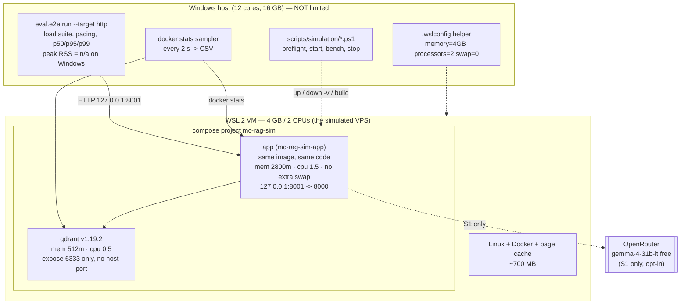
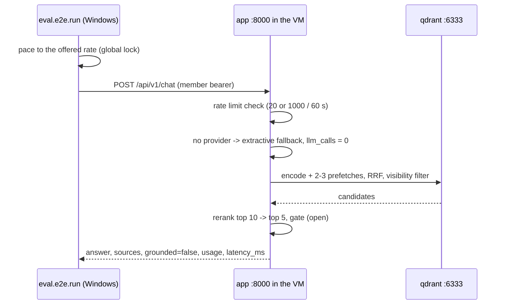

# Design Document: 4 GB / 2-core VPS simulation for MC-RAG

## Overview

This design adds a **measurement layer** around the existing deployment: two Compose overlays, one
environment template, a VM-limit helper, five PowerShell scripts and a runbook, plus two small
changes to the eval harness (configurable request pacing, honest host-RSS reporting).

The production artifacts stay byte-identical: `Dockerfile`, `docker-compose.yml`, `.env.example` and
all application code are untouched. The simulation is a *different Compose project* built from the
same build context, so its containers, network and volumes cannot collide with the normal
deployment, and its app is reachable only on `127.0.0.1:8001`.

Two independent limits are applied and never conflated:

| Layer | Mechanism | Value |
|---|---|---|
| VM | `%UserProfile%\.wslconfig` → WSL 2 VM | `memory=4GB`, `processors=2`, `swap=0` |
| Container | Compose `mem_limit` / `memswap_limit` / `cpus` | app 2800 MB / 1.5 CPU, Qdrant 512 MB / 0.5 CPU |

Generation is out of scope for the capacity numbers: scenario **S0** runs with no provider (the
extractive fallback answers, 0 LLM calls), scenario **S1** adds OpenRouter's free
`google/gemma-4-31b-it:free` with the operator's own key, opt-in, and reported separately.

## Architecture



Request path in a benchmark run (unchanged production path):



## Components and Interfaces

### 1. `docker-compose.simulation.yml` (always applied; structural only)

```yaml
name: mc-rag-sim

services:
  qdrant:
    mem_limit: 512m
    mem_reservation: 256m
    memswap_limit: 512m
    cpus: "0.5"
    pids_limit: 256

  app:
    ports: !override ["127.0.0.1:8001:8000"]
    env_file: !override [.env]
    environment:
      QDRANT_COLLECTION: mcclub_sim
      INGEST_EMBED_THREADS: "2"
      RETRIEVAL_RERANK_THREADS: "2"
      RETRIEVAL_RERANK_WORKERS: "1"
      INGEST_MAX_CONCURRENCY: "1"
    mem_limit: 2800m
    mem_reservation: 1024m
    memswap_limit: 2800m
    cpus: "1.5"
    pids_limit: 512
```

Verified against the installed Compose (v5.3.1) with `docker compose -f docker-compose.yml -f
<overlay> config`, which emitted exactly:

- one published port, `host_ip: 127.0.0.1`, `published: "8001"`, `target: 8000` — the inherited
  `8000:8000` is gone (this is what `!override` buys us; without it the two entries would merge);
- `env_file` = `.env` — the one environment file the project already has, which Git and
  `.dockerignore` both exclude, so there is no second secret to leak;
- the `environment:` block wins over `env_file`, so the simulation gets its own collection and thread
  counts while the dev stack keeps `.env`'s values;
- `mem_limit` / `mem_reservation` / `memswap_limit` / `cpus` / `pids_limit` on both services;
- network `mc-rag-sim_default`, volumes `mc-rag-sim_app_data` and `mc-rag-sim_qdrant_storage` —
  the isolation comes from the project name, so no volume renaming is needed;
- Qdrant keeps `expose: 6333` and still has no host port.

**No second environment file.** The operator's decision: `.env` already exists, is git-ignored and is
docker-ignored, so a `.env.simulation` would only add a second secret to leak. The split is by
*ownership* instead of by file — shared values (credentials, models, production defaults) stay in
`.env`; simulation-only values live in the overlay's `environment:` block, which only the
`mc-rag-sim` project reads. Writing `INGEST_EMBED_THREADS=2` into `.env` would silently change the
normal dev stack too.

### 3. `.env` (existing, git-ignored) — what the simulation reads

| Key | Value | Scenario |
|---|---|---|
| `OPENROUTER_API_KEY` | commented out → retrieval only; uncommented → real generation | S0 / S1 |
| `OPENROUTER_MODEL` | `google/gemma-4-31b-it:free` | S1 |
| `MEMBER_TOKEN`, `ADMIN_API_KEY` | local values, shared with the Windows harness | both |
| `QDRANT_URL` | `http://qdrant:6333` | both |
| `EMBED_MODEL`, `EMBED_DIM`, `RERANK_MODEL` | production values (bge-m3, 1024, mmarco) | both |
| `RETRIEVE_TOP_K`, `RERANK_TOP_N`, `GATE_THRESHOLD` | production defaults | both |
| `LLM_DAILY_LIMIT`, `LLM_RESERVE`, `REWRITE_*` | production defaults | both |
| `CHAT_RATE_LIMIT_REQUESTS` / `_WINDOW_S` | `20` / `60` → Profile A; the overlay raises it for B | A / B |

Settings are read once at startup (`config.get_settings` is `lru_cache`d), so switching S0 ↔ S1 means
editing one line and restarting the app. `.env` ends with a comment block explaining both scenarios
and where the simulation-only values live.

**Stale values found and fixed while preparing it** (the file had drifted from the code since
2026-10-09): `EMBED_MODEL=ibm-granite/granite-embedding-311m-multilingual-r2` with `EMBED_DIM=768`
and `RERANK_MODEL=BAAI/bge-reranker-v2-m3`, plus `RETRIEVE_TOP_K=30`. The image ships bge-m3 (1024)
and mmarco, so those values would have failed the embedder check at startup instead of measuring
anything.

### 3b. Simulation-only values (overlay `environment:` block)

| Key | Value | Why |
|---|---|---|
| `QDRANT_COLLECTION` | `mcclub_sim` | never collides with a dev collection name |
| `INGEST_EMBED_THREADS` | `2` | 2 vCPUs: one per core, not the dev default of 4 |
| `RETRIEVAL_RERANK_THREADS` | `2` | same for the cross-encoder |
| `RETRIEVAL_RERANK_WORKERS` | `1` | each extra session costs ~350 MB; the validator also requires workers ≤ threads |
| `INGEST_MAX_CONCURRENCY` | `1` | OCR and parsing must not compete with serving |

### 2. `docker-compose.simulation.capacity.yml` (Profile B only)

```yaml
services:
  app:
    environment:
      CHAT_RATE_LIMIT_REQUESTS: "1000"
      CHAT_RATE_LIMIT_WINDOW_S: "60"
```

Exactly two keys, nothing else. A test asserts that this file contains no other service and no
other key, so it can never quietly become a second production override.

### 4. VM limits: `scripts/simulation/Set-SimVmLimits.ps1`

Modes, never a blind overwrite:

| Mode | Behaviour |
|---|---|
| `-Mode Show` | print current `.wslconfig` (or "absent"), the file's resolved `[wsl2]` keys, and the **effective** limits from `docker info` (`NCPU`, `MemTotal`) |
| `-Mode Apply` | back up `%UserProfile%\.wslconfig` to `.wslconfig.sim-backup-<UTC timestamp>` (or record "was absent"), merge `memory/processors/swap` into the existing `[wsl2]` section (creating it if needed), then print the exact `wsl --shutdown` + Docker Desktop restart steps |
| `-Mode Restore` | put the backup back (or delete the file if it did not exist) and print the same restart steps |

Safety rules baked into the script: refuse `Apply` when the backup step would fail, never write
outside `%UserProfile%`, keep unknown keys and other sections, and end by printing — never
executing — `wsl --shutdown` (it would kill the running Docker Desktop VM). The verification step
is `docker info --format "{{.NCPU}} {{.MemTotal}}"`, expected `2` and ~`4294000000`.

Documented gotcha: Docker Desktop's own Resources sliders write to the same `.wslconfig`, so the
runbook says to re-check with `-Mode Show` after any Docker Desktop settings change.

Backend alternative (documented, not scripted): if Docker Desktop is not on the WSL 2 backend, the
equivalent is the Docker Desktop VM's Hyper-V settings (`Set-VMMemory`, `Set-VMProcessor`, requires
Hyper-V and an elevated shell); the helper detects this and points at the manual path instead of
guessing. This machine **is** WSL 2 (`docker-desktop` distro, version 2), and `.wslconfig` is
currently **absent**, so `Apply` is a clean create-with-backup-record.

### 5. Build order (why "build before the limits")

The image build runs `uv sync` and `scripts/download_models.py` (bge-m3 568 MB + mmarco 119 MB +
BM25 stopwords + tessdata). Under a 4 GB ceiling with the app not yet running this is the riskiest
moment, so the runbook order is: **build and pull first** (ceiling still at host values), *then*
apply the VM limits, *then* `up -d`. Two consequences worth documenting:

- The sim image is project-scoped (`mc-rag-sim-app`), so the dev stack's image is untouched and the
  sim build is not reused by the dev stack. Cleanup may optionally `docker image rm mc-rag-sim-app`.
- Model files live *inside* the image, so they do not consume the 4 GB runtime budget as a separate
  download; they do consume image disk space (~1.5 GB) on the host.

### 6. Eval harness changes (the only code changes)

**`eval/e2e/run.py`** — new CLI argument:

- `--requests-per-minute N` (int, must be > 0), default `20`, so the current behaviour is
  bit-for-bit preserved when the flag is absent;
- passed as `HttpDriver(args.base_url, requests_per_window=args.requests_per_minute, window_s=60)`
  on the `http` target only (the in-process driver has no pacing);
- recorded in the run's `info` block (`offered_rpm`) so the report states the offered rate next to
  the achieved throughput;
- validated with a small argparse type that raises `argparse.ArgumentTypeError` for `0`/negative, so
  `--requests-per-minute 0` exits with a usage error instead of dividing by zero.

**`eval/e2e/drivers.py`** — `HttpDriver._wait()` becomes concurrency-safe:

```python
async def _wait(self) -> None:
    """Reserve the next slot: the offered rate is a global maximum (Req 6.4)."""
    async with self._pace:
        now = time.monotonic()
        if now < self._next:
            await asyncio.sleep(self._next - now)
        self._next = max(now, self._next) + self.interval
```

The lock is held only while reserving a slot and sleeping, never during the HTTP request, so it
adds no serialization to the actual work — it just prevents N concurrent tasks from reading the same
`_next` and firing together. The class docstring states that the rate is a **maximum offered** rate:
achieved throughput is bounded by latency and saturation (Req 6.5).

**`eval/e2e/system.py`** — the existing `resource` guard stays (it is already correct); the
`peak_rss_mb` field is documented as *the load generator's* peak RSS and `None` where unavailable.
No behaviour change on Linux.

**`eval/e2e/report.py`** — `load_markdown()` gains one line: peak host RSS, printed as `n/a` when
`None`. Today the field is computed but never rendered, so a Windows run silently omits it.

**`pyproject.toml`** — `pyyaml~=6.0` added to the dev dependency group (only the new compose test
needs it; it is already present transitively) and `uv lock` re-run.

### 7. PowerShell scripts (`scripts/simulation/`)

All scripts: `-ErrorAction Stop`, explicit exit codes, idempotent, `Set-StrictMode`, and they never
print a secret. Names, verbs and what each one does:

| Script | Purpose |
|---|---|
| `Test-SimPreflight.ps1` | docker present, daemon up, Compose ≥ 2.24 (`!override`), `.env` exists, `docker compose config` valid for `base+sim` and `base+sim+capacity`, prints the resolved limits **with every secret value redacted** (`docker compose config` prints keys in clear text) and lists the running default-project containers to prove they are untouched |
| `Start-Simulation.ps1` | `-Build` (optional), `up -d`, waits for `/api/v1/health` (default 300 s, models load slowly), prints `docker compose ps`, `docker inspect` limits and the health JSON |
| `Invoke-SimBenchmark.ps1` | runs one labelled load stage over HTTP with `docker stats` sampling to CSV, records OOM kills and restart counts |
| `Stop-Simulation.ps1` | `down -v --project-name mc-rag-sim` behind an interactive confirm (or `-Force`), refuses any project name other than `mc-rag-sim` |

The benchmark script exports `MEMBER_TOKEN` / `ADMIN_API_KEY` into the child process environment by
parsing `.env` **in memory** (`HttpDriver` reads `os.environ`), without echoing the
values. Sample output goes to `eval/results/simulation/<UTC>-<label>.csv`, already git-ignored by
the existing `eval/results/**` rule, so benchmark data never reaches git.

Load stage command (the exact line the script runs, so it is also reproducible by hand):

```powershell
$env:MEMBER_TOKEN = "..."; $env:ADMIN_API_KEY = "..."   # from .env, in memory
uv run python -m eval.e2e.run --target http --base-url http://127.0.0.1:8001 `
  --suite load --concurrency 4 --duration 120 --requests-per-minute 240 `
  --split dev --limit 40 --label sim-b4-240rpm
```

`--split dev --limit 40` keeps each stage bounded: the load suite cycles over the selected cases, so
case variety matters for realism, not corpus size, and a small set keeps the run interpretable.

### 8. Profiles A and B

| | Profile A (default policy) | Profile B (capacity) |
|---|---|---|
| Overlays | `docker-compose.yml` + `.simulation.yml` | + `.simulation.capacity.yml` |
| `CHAT_RATE_LIMIT_REQUESTS` | 20 / 60 s (production) | 1000 / 60 s (test only) |
| Offered rate | 20 rpm or lower | 60 → 120 → 240 → 480 rpm |
| Concurrency | 1, then 2 | 1×30 s, 2×60 s, 4×120 s, 8×120 s |
| What it answers | "what does the shipped policy do from one client IP?" | "where does the 4 GB / 2-core box saturate?" |

Both profiles use the same URL, the same corpus and the same script; only the overlay and the flags
differ. The runbook states that Profile B's rate limit is a deliberate test-only value and not a
production security recommendation.

## Data Models

No new application schema. The simulation adds three artifacts:

| Artifact | Shape | Lifetime |
|---|---|---|
| `.env` | `KEY=VALUE` lines, the app's own settings file, shared with the dev stack | local, git-ignored |
| `.wslconfig.sim-backup-<UTC>` | copy of the previous `.wslconfig` (or a marker that there was none) | local, outside the repo |
| `eval/results/simulation/<UTC>-<label>.csv` | `ts,name,mem_used_mb,mem_pct,cpu_pct,net_io,block_io` from `docker stats` | local, git-ignored |

Benchmark verdicts reuse the existing eval outputs (`eval/results/e2e/<UTC>-<label>.{json,md}`),
which already carry `throughput_rps`, `p50_ms`, `p95_ms`, `p99_ms`, `error_rate`, `rate_limited`,
`peak_rss_mb` and the per-stage retrieval timings.

## Error Handling

| Failure | Detection | Behaviour / message |
|---|---|---|
| Docker daemon down | `docker info` fails | scripts exit 2 with "start Docker Desktop"; `Set-SimVmLimits -Mode Show` still prints the file state |
| Compose too old for `!override` | `docker compose version` | preflight exits 3, requires ≥ 2.24 (here: 5.3.1) |
| `.env` missing | `Test-Path` | preflight exits 4 and names the file to copy from `.env.example` (this also explains why `docker compose config` fails before it exists — observed) |
| Secrets printed by `docker compose config` | the resolved config prints every key in clear text | preflight and the start script redact `OPENROUTER_API_KEY`, `MEMBER_TOKEN`, `ADMIN_API_KEY`, `EVAL_JUDGE_API_KEY` before showing anything |
| Simulation values leaking into the dev stack | a simulation-only key found in `.env` | preflight fails when `docker-compose.simulation.yml`'s `environment:` keys appear in `.env`, and lists where each one is set |
| OOM kill of a container | `docker inspect --format {{.State.OOMKilled}}` + `RestartCount` after each stage | recorded in the CSV summary; runbook says stop escalating |
| App never healthy | health poll timeout (300 s) | print `docker compose logs --tail 50 app` and the container state, then exit 5 |
| Insufficient memory during build | build fails / WSL killed | runbook: build before applying the ceiling (stage order), and if unavoidable, raise the ceiling temporarily, build, re-apply |
| 429 storm | `rate_limited` in the run stats | Profile A: expected and reported; Profile B: means the overlay was not applied |
| Eval harness crash | exit code 2 from `eval.e2e.run` | report distinguishes a crash from a failed scorecard, as it already does |

Expected, **not** failures: `GET /api/v1/health` → `{"status": "degraded"}` in S0 (no provider),
and chat answers with `grounded: false`, `usage.llm_calls = 0` and the passages as sources. The
retrieval stack is fully functional in that state; the health route requires the provider probe
(`main.py:257` returns the key's truthiness).

## Testing Strategy

**Automated, no models, no Docker (always run):** `tests/test_simulation_compose.py`

- parses both overlays with a `!override`-aware `yaml.SafeLoader` subclass;
- asserts project name, the single loopback port, `env_file == [".env"]`, `mem_limit ==
  memswap_limit` and `cpus` on both services, and that Qdrant has no `ports` key;
- asserts the simulation overlay's `environment:` block holds exactly the five simulation-only keys
  with the documented values, and that none of them is also set in `.env.example` (they would
  silently change the dev stack);
- asserts the capacity overlay contains exactly `services.app.environment` with the two rate keys;
- asserts `.gitignore` and `.dockerignore` both list `.env`, and that no `.env.simulation*` file
  exists in the repository;
- scans `git ls-files` for `sk-or-v1` (a repo-wide secret guard, given keys get pasted into chats).

**Automated, harness changes:** `tests/test_e2e_driver.py` (default interval 3.0 s for 20/60; custom
rate applied; `--requests-per-minute 0` and `-5` rejected; 8 concurrent `chat()` calls spaced by at
least `interval/2` — a burst would fail), new `tests/test_e2e_system.py` (`resource` absent →
`peak_rss_mb is None`, `load()` returns stats, `load_markdown()` renders `n/a`), and a case in
`tests/test_e2e_report.py` for the same rendering.

**Static:** `uv run ruff check .`, `uv run ruff format --check .`, `uv lock --check`, and the fast
suite (`-m "not ocr and not tokenizer and not embedder and not reranker"`).

**Compose validation (needs the CLI, not the daemon):** `docker compose -f docker-compose.yml -f
docker-compose.simulation.yml [-f docker-compose.simulation.capacity.yml] config` — already proven to
work here with the daemon down; preflight runs it and fails on any error.

**Runtime (needs the daemon):** the eight staged commands in the runbook. Every runtime number in
the final report comes from an actual run; until the daemon is up, the report says "not measured"
rather than estimating.

## Requirement traceability

| Requirement | Artifact | Verification |
|---|---|---|
| 1 (isolated stack) | overlays + project name | compose test, `docker compose config` output, `Stop-Simulation.ps1` guard |
| 2 (VM ceiling) | `Set-SimVmLimits.ps1` | `-Mode Show` verification against `docker info` |
| 3 (container budgets) | overlay limits | compose test (`mem_limit == memswap_limit`, `cpus`) |
| 4 (secrets/data isolation) | overlay `environment:`, `.env`, `.gitignore`, `.dockerignore` | compose test, secret scan |
| 5, 5b (health + scenarios) | runbook S0/S1 | documented expected outputs; S1 opt-in only |
| 5c (credential hygiene) | `.env` (git- and docker-ignored), redaction in the scripts | secret scan, ignore-file test |
| 6 (pacing) | `run.py`, `drivers.py` | driver tests + CLI validation test |
| 7 (host RSS) | `system.py`, `report.py` | new system/report tests |
| 8 (profiles) | capacity overlay, runbook | capacity-overlay test |
| 9 (runbook) | `scripts/simulation/*.ps1`, `docs/simulation/4gb-vps.md` | preflight idempotency, runbook reviewed |
| 10 (staged plan) | `Invoke-SimBenchmark.ps1` stages | each stage's CSV + eval JSON |
| 11 (automated verification) | tests above | ruff, fast suite, `compose config` |
| 12 (guardrails) | no changes to Dockerfile / base compose / `.env.example` / app code | final diff review |
